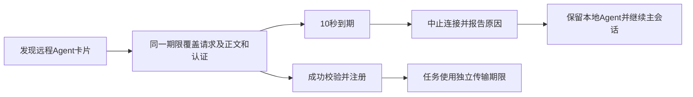

# Gemini Ultra CLI 远程 Agent 发现上限交接

日期：2026-11-11。WI-077/E-170，preview.45候选。沿用自有源码case
R26/code-audit、lead/cae/doc，仅本地CLI与迟滞loopback服务，无外部安全目标、付费模型调用或个人配置变更。

## 复现与修复

registry.registerRemoteAgent会await
A2AClientManager.loadAgent；原卡片解析器直接复用30分钟任务传输dispatcher，SDK在fetch后还会await
response.json()，没有独立发现上限。用已安装preview.44实际CLI、隔离profile和本地卡片端点复现：卡片11512ms才返回有效元数据，CLI总12888ms，主对话必须等卡片返回才向loopback模型发送一次请求，退出0。没有等待30分钟；30分钟配置来自当前源码，11512ms等待来自实际记录。

卡片发现现在单次10秒上限，覆盖SDK
resolver、响应正文、401/403后的认证回调和重试，不把只收到响应头当完成。到时明确报告“Agent
card discovery exceeded 10
seconds”，中止HTTP请求，保留本地Agent及主会话继续运行。到期后迟到的卡片结果不进入客户端/卡片缓存。

401/403只有存在认证处理器才重试，重试沿用同一个发现期限，先取消未使用的初次响应正文。保留调用者在Request或init里提供的取消信号；成功/失败时清理期限计时器和初始卡片连接，缓存解析器之后仍可继续使用。计时器在发现期间保活，避免无I/O的认证回调让非交互CLI无声退出。

任务传输继续使用原30分钟专用dispatcher及原调用者signal，卡片短期限不传入任务请求。内联JSON无网络解析上限，不改变原字段校验和协议选择；未注册失败Agent，不改用户定义文件，可在端点恢复后重新加载。

## 必要验证

- 35个A2A管理器相关用例通过（6新增、29原有），覆盖卡住的resolver、已收头但正文不返回、认证回调不返回、旧结果迟到、无认证不重复401、Request取消，以及成功缓存/代理/协议/流与任务调用兼容。相关严格lint/type通过。没有跑全量或冒烟。
- 源码实际CLI面对永不发响应头的本地端点：卡片10018ms后被客户端中止，报告超时诊断，主会话继续并收到一次loopback响应，CLI退出0、总11956ms，无外层watchdog触发。原本地Agent注册仍可继续；没有自动重试卡片或付费模型。工程脚本从服务器response.close观察连接中止，不把仅停止await等同于取消请求。
- 源码临时bundle的报告metadata仍是仓库上游nightly版本；它是开发链证据，候选preview.45的最终包身份待三平台核对。上述修前是延迟后有效返回，修后是永不返回，两者不作速度百分比比较。

Evidence→Finding→Path：preview44-discovery-before.json/-output.txt、SDK
resolver与A2A原超时配置 → F-044远程元数据发现沿用长任务等待，阻断初始化 →
E-170独立发现期限、实际连接中止和主会话继续。

工程根C:\Users\Administrator\Documents\ChatGPT\gmncliu：agent-card-deadline-delivery-junit.xml/-test.log、-delivery-lint.log、-delivery-types.log、-source.json/-source-output.txt、preview44-discovery-before.json/-output.txt。源码scripts/verify-ultra-agent-discovery.mjs给出可复现的隔离CLI场景，默认永不返回卡片，baseline参数为11.5秒后有效返回。仅调用loopback模型，不使用用户凭据。

## 分发与目标池

候选preview.45准备三平台最终包核对与Windows安装；CI新增同源已安装CLI迟滞发现检查，单平台一次本地卡片失败和一次loopback主模型响应。不重复其他本机fixture/真实付费任务，不合并master、不正式Release。

10秒是单次卡片发现上限，不是整个启动总上限；多个依次加载的扩展或认证提供器创建阶段可能另有等待。未证明所有外部认证方案、真实远程长任务、所有电脑交互启动或整体正式上线。WI-077本地完成，goal
active；继续维护完整目标，不用这个定向场景替代真实Teamwork长任务、更多模型、复杂逆向或摘要准确性的剩余验收。
