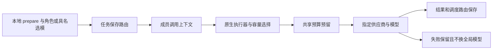

# Gemini Ultra CLI 成员独立模型交接

日期：2026-11-11。候选 preview.38；本机此刻仍 preview.37。

## E-147 成员模型路由

沿用 R26/code-audit、lead/cae/doc 与既有本地授权。新增协作调用内的 AsyncLocalStorage 模型上下文，覆盖 LocalSubagentInvocation 和 LocalSessionInvocation 共同使用的 LocalAgentExecutor。执行器及压缩容量读取成员路由，统一生成入口执行最终供应商选择；不并发修改全局 activeModel、供应商文件或共享注册表别名。

用户可以给 researcher、coder、workflow-auditor 选择不同供应商/模型，也可以覆盖 Swarm 的 @具名成员。配置按项目任务持久化，恢复后保留。具名覆盖优先于角色，inherit 清除当前层覆盖；为尚未创建的 @成员预设后，首轮即使用预设模型，不必先花一轮再改。排队/运行中的成员拒绝改模，工作流运行期间拒绝角色改模，后续轮次/阶段才接收新设置。

路由格式为 `供应商ID:模型ID`，支持中文供应商/模型名称、手动模型 ID；或
`native:gemini-模型ID`
显式使用已有原生 Gemini 通道。原生通道仍需本机已有可用认证，不会自动改认证。指定供应商不存在/被删除时明确失败，不回退到其他供应商。显式成员发生 429 等失败时，不执行会话级换模策略、不改变主会话或其他成员的全局模型；已有任务预算继续限制实际应用调度。

安全模型目录只列已配置 qualifiedId，不含端点、密钥或自定义 headers，不联网探测。状态/看板显示选择；成员及工作流阶段报告保存生成器实际分发的 modelsUsed 路由。这里表示调用尝试的供应商/模型参数，不声称能证明服务商内部部署的真实模型。最多保留16条路由；超长继承名称仅截断显示并注明，不改变发给供应商的模型。

## 本地使用

先用 `/swarm prepare 任务内容` 创建任务而不调用模型，再用 `/swarm model`
查看本地模型目录和用法。随后用 `/swarm model researcher 供应商ID:模型ID`
配角色，或 `/swarm model @author 供应商ID:模型ID` 预设具名成员；`/swarm resume`
才开始协调执行。

Boost 同样有 `/boost prepare 任务内容` → `/boost model 角色 供应商ID:模型ID` →
`/boost resume`。Teamwork 在原需求对齐/批准流程里通过 `/teamwork model`
配角色，不跳过草案批准。已有直接 `/boost 任务` 和 `/swarm 任务`
入口继续使用继承模型，可随任务状态选择后续轮次模型。

模型目录和配置、prepare 都是本地命令，不提交模型 prompt、不重置累计用量。原生红队工具权限和 scope 不因选模改变；不是免除授权或审批的入口。

## 必要验证

- 23 个相关 core 用例通过：选模5、既有Swarm7、工作流11；10 个 CLI 命令用例通过。覆盖并行不同供应商/容量不串线、主路由及供应商文件不变、原生通道、已删供应商不回落、显式成员错误不触碰父会话换模策略、角色/具名覆盖和预设、中文名称、prepare/本地配置零 prompt、共享预算与报告路由。
- 受影响严格 lint、core/CLI 类型构建、格式及脚本语法检查通过。仅相关检查，无全量/冒烟，没有付费模型请求。
- 源码 bundle 用三个不同 loopback 供应商路径和模型 ID，实际原生执行器读写工件并独立审查，主会话仍走原路由：

| 编排        | 本地执行入口            | 请求数 | 时长   | 退出码 |
| ----------- | ----------------------- | ------ | ------ | ------ |
| Swarm       | LocalSubagentInvocation | 20     | 2720ms | 0      |
| Swarm       | LocalSessionInvocation  | 20     | 2097ms | 0      |
| Boost工作流 | LocalSubagentInvocation | 12     | 1703ms | 0      |
| Boost工作流 | LocalSessionInvocation  | 12     | 1696ms | 0      |

这些源码链在最后 prepare/具名预设和429隔离补齐前运行；后续相关定向用例已通过，最终源码由本轮 CI 工件再次执行同四条链。Swarm累计18次任务调度，工作流累计10次成员调度；fixture第一个请求创建隔离状态、最后总结在完成后，因此与总HTTP请求数不同。服务响应为模拟内容，证明实际路由/原生执行接线，不是三个真实供应商的自主交付验收。

Evidence→Path：用户要求真正多Agent协作及模型配置便利性 → WI-068 →
E-147 调用内路由、prepare与本地配置、两入口实际协议链和累计预算/路由记录。

工程目录：agent-model-core.log、agent-model-chinese-core.log及junit；agent-model-cli.log、agent-model-prepared-cli.log及junit；agent-model-types-delivery.log、agent-model-delivery-lint.log与相关lint；agent-model-swarm-source.json、agent-model-swarm-session-source.json、agent-model-workflow-source.json、agent-model-workflow-session-source.json及各输出。不把源码bundle身份当成已安装最终CI包身份。

## 接续

WI-068 本地实现完成，preview.38 待三平台分发/本机安装核对。下一步 WI-069 推进可选 Git 工作树隔离与回收/结果整合，不并发覆盖共享工作区；现有共享模式仍串行writer/verifier。WI-054 真实供应商完整自主交付/引用、WI-056 复杂逆向继续。多模型配置不自动证明模型质量或全部上线验收；goal
active，不合并 master、不正式发布 Release。
