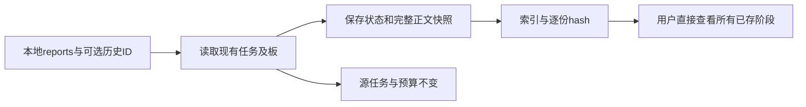

# Gemini Ultra CLI 历史报告入口交接

日期：2026-11-11。WI-073/E-160，本机双命令已安装preview.42，产品源895dad5235999b0fad4464d2cea21115a1dc1383。沿用R26/code-audit自有源码case、lead/cae/doc；仅本地记录导出及loopback检查，没有新增真实模型调用。

## 用户入口

新增本地命令
`/boost reports [ID]`、`/teamwork reports [ID]`、`/grill-me reports [ID]`、`/swarm reports [ID]`。无ID取当前项目对应模式最近的保存记录；指定ID可以直接读历史记录，不被无关latest/current绑定损坏阻断。模式不匹配或ID损坏明确报错，不猜另一任务、不恢复/覆盖源数据。已完成/取消/受阻记录都能导出，不因completed
early-return而失去入口。

命令输出indexPath、manifestPath、任务状态、报告数量及snapshotSha256。index.md链接全部已保存阶段正文（不只近期4份），Swarm包含每成员当前已保存结果及公开board.jsonl。原记录快照snapshot.json保留批准/阶段/失败状态、模型路由/预算等元数据；manifest逐份记录正文SHA-256与UTF-8字节数。中文/英文模式生成对应语言索引，原模型正文不翻译，语言纳入快照目录身份，切换语言不会覆盖旧索引。

输出位于项目临时目录
`agent-reports/<ID>/<snapshotSHA>/`，只写派生报告，不改原任务/账本/板。相同内容重复调用复用原文件；内容变化产生新快照，不覆写旧版本。已有快照文件被用户修改时拒绝覆盖，保留修改及原任务。所有文件均本地，不发送模型、不读取供应商凭据文件，不自动打开浏览器；任务正文原样保留，可能包含用户自己的私密内容。

这是已保存报告的完整索引，不是任意交付物的便携打包器：模型正文引用的源文件/反编译工件/补丁仍在原路径，导出不自动遍历或复制它们，也不重新验证审查结论；既有记录自身截断、丢失或已清理的工件不能凭导出恢复。Swarm成员正文是当前已保存的轮次结果，历史公开通信以现有有界板记录为准，不声称保存全部已超出上限的历史。私有任务内容应由用户决定分享范围。

## E-160 必要证据

- 3项core检查通过：6份长中文阶段正文全量导出/逐份hash，blocked与失败阶段保留，原记录/预算字节不变；取消Swarm的killed成员结果和原板保留，不复活任务；空访谈不伪造报告、非法/损坏ID拒绝。重复导出、修改后拒绝覆盖、中英文索引并存也并入相关用例。
- 12项CLI命令检查通过，包含两个新用例：已完成工作流和Swarm按显式ID导出，绕过损坏的无关latest/current绑定，不返回submit_prompt、不改源记录；保留已有预算/选模/prepare/取消命令验证。严格相关lint、core/CLI类型构建通过；不做全量或冒烟。
- 源码bundle实际CLI链：Boost原生五阶段完成后 `/boost reports ID`
  退出0、13个loopback请求保持不增，5份报告含原长调查中段全保留；4355ms。Swarm工作树回写/回收后
  `/swarm reports ID`
  退出0、21请求保持，3成员报告/板/索引生成，24949ms。时长包含原链，不代表报告命令单独耗时。最后中英文索引补齐由同源最终CI包核对，不重跑相同源码链。
- 直接对E-156真实Boost留存记录导出：5份阶段原文逐字节匹配、逐份hash通过，原工作流JSON字节不变，重复导出结果相同；没有付费调用。工程agent-reports-retained-boost-result.json提供当前索引路径。

最初lint发现新增测试const多变量声明，已按仓库规则拆开，不放宽规则；原日志保留。

Evidence→Finding→Path：用户要求完整可用的协作Agent
→ 现有status只能看阶段、completed后没有完整报告入口 →
WI-073/E-160本地历史reports及原文/状态/hash保留。导出成功不代替业务完成或新独立审查。

工程根C:\Users\Administrator\Documents\ChatGPT\gmncliu：agent-reports-final-core.log及junit、agent-reports-cli.log及junit、agent-reports-final-types.log、agent-reports-delivery-lint.log；agent-reports-workflow-source.json、agent-reports-swarm-source.json及日志；agent-reports-retained-boost-result.json与export-retained-boost-reports.mts。源数据仍为preview40-live-boost-reverse-records/workspace。

## 接续

WI-073本地实现完成，preview.42待三平台最终包及本机安装核对。本阶段不改模型供应商/用户数据库/逆向工具，不重跑旧付费任务，原E-156两处措辞问题和E-124失败保留。真实Swarm/更多模型/长任务与更复杂逆向仍未验收，整体goal
active，仅codex隔离分支、不合并master、不正式Release。

## E-161 三平台最终包

[运行42921998772](https://github.com/emstudio010-hub/gemini-ultra-cli/actions/runs/42921998772)
completed/success，产品源895dad5235999b0fad4464d2cea21115a1dc1383。版本、包SHA、源码运行身份、安装报告、六rg二进制hash及Unix权限核对通过。同源既有多模型两入口、预算/恢复、工作树/长交接及原生Ghidra链通过。

| 平台        | 包SHA-256                                                        | Boost完整交接/本地报告链 | Swarm工作树/本地报告链 |
| ----------- | ---------------------------------------------------------------- | ------------------------ | ---------------------- |
| Windows x64 | 43e8420650dd92f09252256a9a95d51ac2c27f6ed648de2c6984358419974baf | 3077ms / 13请求          | 23222ms / 21请求       |
| Linux x64   | 903445c205029ec168b73d4952aa150c8481b16048705ae53f1f0d200132d96b | 1638ms / 13请求          | 7182ms / 21请求        |
| macOS arm64 | fcf92f96874bde454390b0148f53495147034c733935642a5219797025941843 | 1880ms / 13请求          | 7718ms / 21请求        |

三平台每条链均退出0。Boost原生五阶段完成后实际CLI /boost reports
ID保存5份完整报告，原长正文及源记录字节保持；Swarm工作树回写/回收后实际/swarm
reports
ID保存3成员结果与板、索引，模型请求不增加。以上时长包含整个链，不作报告命令单独耗时或跨平台性能比较；响应仅loopback，不扩大真实业务验收。

## E-162 本机安装

一次offline已有缓存安装7250ms/退出0；gemini-ultra与gemini-ultra-cli均1.0.0-preview.42，424包内文件逐一匹配Windows
CI包。入口SHA
19108569c81ada7c9608d36d6cc63d9fef56c30716b8f8ee46369c58769ed991；旧preview.41包保留。未重复Windows同工件fixture或真实付费任务，不改个人供应商配置、数据库及逆向工具。

工程记录：github-preview42-run.json、github-preview42-artifacts-result.json、github-run-42921998772各平台workflow-context-verification.json、worktree-verification.json及输出；global-preview42-install-result.json、global-install-github-preview42-full-result.json。源码/工程/Obsidian交接同步。

WI-073交付，goal
active。报告命令是已有保存结果的可用入口，不代替新的独立审查或外部工件打包，不把E-124失败/未知历史改成通过。真实Swarm/更多模型/长任务、摘要准确性及更复杂逆向仍有边界，仅codex隔离分支、不合并master、不正式Release。
