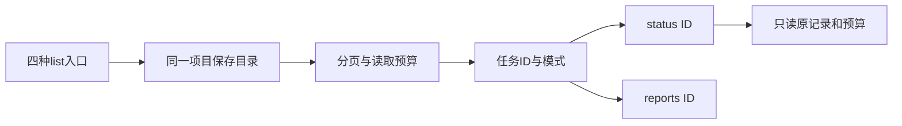

# Gemini Ultra CLI 历史 Agent 任务目录交接

日期：2026-11-11。WI-085/E-195/F-053，候选 preview.53。沿用 R26/code-audit 自有源码 case、lead/cae/doc。没有付费模型、外部安全目标、个人配置/数据库或逆向工具安装改动。

## 发现与实现

E-195/F-053：工作流和 Swarm 状态命令忽略传入的 ID。已安装 preview.52 实际输入旧 Teamwork
ID，输出却是 CURRENT_TEAMWORK_NEWER 及另一个 ID，并触发该最新记录的旧账本初始化。原生复现两条本地命令、0模型请求，在错误结果处失败退出，原输出和 JSON 保留。Swarm 旧回归也显示：即使明确指定旧 ID，损坏的 latest 绑定仍阻断读取。

新增项目任务目录：`/teamwork list`、`/boost list`、`/grill-me list`、`/swarm list`
是同一份目录的入口，混合列出四种保存任务，按文件保存时间排序、每页20项、支持页码。每页读取正文预算16MiB；坏记录/未加载详情可见，原文不回显为错误消息；链接文件不跟随，重定向的目录明确拒绝。仍需枚举目录元数据，不把16MiB预算当总耗时或目录规模上限。

`status <ID>`
直接读取指定记录，工作流检查模式，Swarm 可绕过无关的坏 latest 绑定。工作流历史预算使用新的只读摘要，缺失/损坏时显示不可用，未知用量保持未知，不初始化账本。目录与指定 ID 状态保留记录/预算/绑定字节，保持当前活动任务和批准状态。恢复仍沿用已有 resume 流程，本轮没有新增历史任务执行选择器。

目录标签、状态与主命令描述随当前语言变化；原始目标保留，只对列表预览去除终端转义和换行并限长。下一页和各行状态/报告提示给出完整斜杠命令。list/status 的补全保留参数输入空间，两者可在忙碌时只读使用，列表不提交模型提示。

Evidence → Finding → Path：E-195 安装版实际错误 ID/旧 Swarm 回归 →
F-053 参数被忽略、依赖最近绑定而无法检查历史 → 项目目录、直接 ID 读取和只读预算 → 原生命令、记录/绑定逐文件哈希及零请求计数。

## 验证

5项目录检查通过：四种类型与坏绑定共存、分页无重复、坏记录保留且不泄漏原文、正文上限、目录链接拒绝。15项命令检查中14项首轮通过，工作流历史夹具先删除旧账本而留下指针，导致新任务未建成；调整为新任务建立后再删除旧账本，单独复核该项通过。共20项不同检查，未重复已通过的14项。最初旧工作流单测也先坏在该夹具顺序，不能拿它冒充旧产品 ID 缺陷证据；真正的旧工作流缺陷由安装版实际输出确认。相关严格 lint/type 退出0，lint 的一处测试 const 声明格式修正后通过。

最终源码原生链16条命令，12退出0/4预期42/0模型请求；夹具含25条保存记录及29个记录/所有者/留言/绑定文件，逐文件 SHA 前后匹配，旧账本仍不存在。覆盖四入口、分页、中英文和中文别名、错模式/坏ID/坏页码、坏绑定下指定状态。记录由宿主种入，不代表实际工作流交付成功；源码报告版本取上游 nightly 根包，最终安装包另核对。UI 细化前一次源码链也通过，最终以 final 记录为准。

工程目录 C:\Users\Administrator\Documents\ChatGPT\gmncliu：`agent-catalog-before*`、`agent-catalog-core-*`、`agent-catalog-command-*`、`agent-catalog-types.log`、`agent-catalog-final-types.log`、`agent-catalog-lint.log`、`agent-catalog-final-lint.log`、`agent-catalog-final-command-lint.log`；旧安装版
`agent-catalog-installed52-before*`；源码 `agent-catalog-source*`，最终
`agent-catalog-source-final*`。

## 分发与边界

候选53使用 agent-catalog 范围：三平台新鲜包/安装、上述16条本地命令。未受影响协作47、供应商48、报告49、提交恢复50、Ghidra51、压缩保护52基线保留。最终源码身份、CI、包哈希和安装结果待本阶段追加。

本轮没有重新执行或重试任何付费任务。真实 Teamwork 长任务、更多模型、长会话语义完整性、复杂逆向和跨机器实际交互继续，goal
active。不合并 master 或创建正式 Release。
