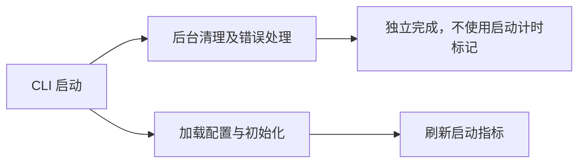

# Gemini Ultra CLI 后台清理计时交接

日期：2026-11-11。当前版本：**1.0.0-preview.29**，产品源码提交
`d27525b22e405392c260d19ffd599a679afc0924`。本机两个 CLI 命令已安装 Windows
CI 工件。

## 问题与修复

E-113 /
F-032：preview.28 的 Linux 成功记录中，cleanup_ops 先报告未结束，随后报告 start
mark 已被清除。源码可达路径是 gemini.tsx 发起后台 Promise.all 清理，同时启动 cleanup_ops 计时；config.initialize 完成后 flush 会警告并清除尚未结束的阶段；后台 finally 再调用 end，因计时标记消失产生第二条告警。交互界面刷新启动指标时也存在相同的异步时序。

修复仅移除后台清理的启动阶段计时。checkpoint、工具输出和后台日志清理仍独立执行，原错误处理保留，启动流程不增加 await。真实清理错误仍会报告；不通过屏蔽日志掩盖错误，也不修改全局 profiler 的正常阶段语义。

Evidence：原 Linux
native-analysis-output.txt 两条告警，以及 gemini.tsx 和 startupProfiler.ts 的生命周期核对。Finding：后台工作生命周期超过启动统计窗口，引起虚假异常与不完整的启动指标。Path：移除非启动等待路径的计时，继续异步清理；对应 WI-058。

## 必要检查

- 受影响 gemini.tsx 与打包脚本严格 ESLint 退出0。
- npx tsc -b packages/core packages/cli 退出0。
- Prettier 与 git diff --check 通过。
- 低影响删减不新增测试，不跑全量或冒烟；不为此重复付费任务或原生逆向链。

## 分发与边界

E-114：[运行 42871470118](https://github.com/emstudio010-hub/gemini-ultra-cli/actions/runs/42871470118)
三平台 completed/success，与上述产品源提交一致。三个工件校验和、安装记录、版本及包内六个 rg 二进制 SHA 和 Unix 可执行权限均核对通过。现有分发检查使用隔离配置及 loopback 模型 fixture，不消耗真实模型调用。

| 平台        | 安装包 SHA-256                                                   |
| ----------- | ---------------------------------------------------------------- |
| Windows x64 | 68a7d71811a7a8013f23c06322dc91775eb905b2eb92eada3a4445e027daad62 |
| Linux x64   | 2989fa227da877b60fb5e49c524343ce50262512b27d141a7213a6b048e30c66 |
| macOS arm64 | 357092cc3b9ba16bfe9ae9413c9ca836d3877c794f2672605f86be36c9e76fef |

E-115：本机已有依赖缓存，offline 全局安装7秒，双命令均为 preview.29，424 个包内文件逐一匹配 Windows
CI 工件；入口 SHA-256
`189f25999a3ae0345c18347d834da5591cbecc2983bb659f10ccc03cfcb50e78`。核对全部已安装 JavaScript 模块，不含 cleanup_ops 阶段名称，运行时块仍含原清理错误报告；这是工件核对，不冒称人为诱发慢清理的运行实验。首次只读取加载入口，没有覆盖动态运行时块，该初步记录单独保留，以完整模块核对为准。

preview.28 的三平台实际 r2 三视图证据保留，本次没有改动该工具或重复原生分析。旧 Windows
CI 包仍保留，可回退安装；用户模型配置、数据库和逆向工具安装未更改。仅推送 codex 分支，不合并 master 或发布正式 Release。

原始证据位于 `C:\Users\Administrator\Documents\ChatGPT\gmncliu`：

- background-cleanup-preview29-result.json。
- github-preview29-run.json、github-preview29-artifacts-result.json。
- global-install-github-preview29-full-result.json。
- installed-preview29-cleanup-artifact-review.json。

复杂反编译、完整无人介入多 Agent 收尾及模型引用可靠性仍待完成；整体目标保持 active。
