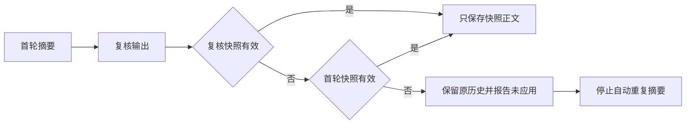

# Gemini Ultra CLI 压缩快照保护交接

日期：2026-11-11。WI-084/E-192/F-052，preview.52 已安装。沿用 R26/code-audit 自有源码 scope 与 lead/cae/doc。没有付费模型、外部安全目标、个人配置/数据库或逆向工具安装改动。

## 发现与修复

E-192：旧实现把任何非空复核回复当最终摘要。一句确认语可以覆盖完整摘要；两轮都不是状态快照时，也会替换原历史并报告压缩成功。两个定向回归先在旧实现失败。已安装 preview.51 实际 CLI 的 loopback 流程也复现：fallback 场景正常退出却把 ACK 文本放入后续上下文，首轮快照丢失；invalid 场景未抑制后续摘要请求，第三次被本地观察器明确拒绝。原始失败记录不覆盖。

`extractCompressionSnapshot`
按既定压缩提示词检查唯一完整根、七个章节及非空目标/任务状态；拒绝重复章节、截断、缺字段、空模板、多个根和未闭合的思考段。仅提取快照正文，保留原事实文本中的比较符、路径和代码，不用严格 XML 解析器改写原文。复核无效时回退到首轮有效快照；两者均无效返回新增 INVALID_SUMMARY，原历史不替换。空回复继续使用原 EMPTY_SUMMARY 状态，原枚举值保持兼容。

主会话和本地成员 Agent 对自动空/无效摘要设置既有失败标志，后续仅按原策略保存/截断工具输出，不再自动反复请求摘要；显式手动压缩仍可重试。普通模式最多两轮，fast 仅一轮，没有新增模型重试。CLI 对无效快照显示当前语言的“压缩未应用、原会话保留”提示。

Evidence → Finding → Path：E-192 旧单测与安装版实际上下文 →
F-052 任意非空回复覆盖摘要和原历史 → 结构校验、首轮回退、失败保留与自动失败标志 → 原生 CLI 连续工具任务中的上下文、工具对与请求计数核对。结构合法不等于语义完整，不能把本轮视为长会话事实准确性已全面验收。

## 定向证据

57项相关 core 检查：初次56通过/1旧夹具失败，真实结构快照比旧纯文本占用更多空间；把该用例的原容量从100改为1000（仍低于500k压缩阈值），单独复核通过。没有修改产品的 Token 膨胀保护，也没有重跑已通过的56项。另1项 CLI 失败提示通过，共58项不同检查已通过，相关严格 lint/type 退出0。

源码原生 CLI 两场景通过，fallback 3主请求+2摘要请求，invalid
4主请求+2摘要请求，合计11个 loopback 请求。实际读取生成文件，后续上下文验证首轮完整快照/原始目标与旧证据、近期工具结果及调用配对；原文件哈希不变、各退出0。模拟用量70000只用于触发128k窗口内的压缩阈值，不是实际大上下文、费用或质量基准。源码报告 version 来自上游根包 nightly 元数据，最终包身份另核对。

首个源码场景使用600000模拟用量，超过128k窗口，invalid 场景因此正常触发窗口保护而未继续。改为70000后最终脚本通过；原失败保留，非产品故障。安装版旧失败与源码初次记录使用旧用量值，不据此比较性能。

工程目录 C:\Users\Administrator\Documents\ChatGPT\gmncliu：`compression-snapshot-before*`、`compression-snapshot-junit.xml`、`compression-snapshot-test.log`、`compression-snapshot-fixture-*`、`compression-snapshot-ui-*`、`compression-snapshot-types.log`、`compression-snapshot-lint.log`、`compression-snapshot-script-lint.log`；安装版旧记录
`compression-snapshot-installed51-before*`；源码初次
`compression-snapshot-source*`，最终以 `compression-snapshot-source-final*`
为准。

## 分发与边界

52使用 compression-snapshot 范围，只做三平台新鲜包/安装和上述两条原生流程。未受影响协作、供应商、报告、提交恢复和 Ghidra 分别沿用47/48/49/50/51基线，不重复未受影响链。

E-193：产品源 `6323a5683666f7f4308b5fe9d53cb1f6a6b62683`，
[run 43038706202](https://github.com/emstudio010-hub/gemini-ultra-cli/actions/runs/43038706202)
三平台 completed/success。版本/源码身份/包 SHA、六份 rg 哈希及执行权限、安装和4个基础工具核对通过；每平台两条原生流程各3+2及4+2请求，合计11个 loopback 请求，均退出0/全部 checks 为真。独立读取归档的最终上下文，核对约束/路径/待办与原历史保留、工具配对及无 ACK/思考段污染，没有只依赖 passed 字段。未受影响旧链 skipped。

E-194：Windows
CI 包 offline 已有缓存安装7878ms/退出0，双命令 preview.52，425文件匹配，旧包保留。包 SHA256 为
`d0910c329cdcd5352dfef7830afcae2d64c823d096c316f89a8d435858959b66`，入口 SHA256 为
`899ee20a0fb51613971bfc0fd6c0b8e8f7fd6f8de22d9b89b501535455f0df2c`。没有重复本机业务链、启动微基准或付费任务。旧失败及夹具修正记录保留，不把旧失败覆盖成成功。

最终证据：`github-preview52-run.json`、`github-preview52-artifacts-result.json`、`github-run-43038706202/`、`global-preview52-install-result.json`、`global-install-github-preview52-full-result.json`。WI-084修复与分发交付，源码、工程正式报告和 Obsidian 交接同步。

真实模型长会话的语义完整性、真实 Teamwork 长任务、更多模型和复杂逆向继续，goal
active。结构检查没有独立证明模型事实正确，也没有恢复旧摘要已经遗漏的信息。不自动重复付费任务，不合并 master 或创建正式 Release。
