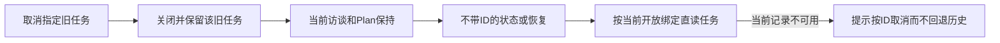

# Gemini Ultra CLI 当前任务与取消权限交接

日期：2026-11-12。WI-124/125，E-304至306，F-084/085。持续目标active。保持源码优先、Windows定向验证、功能收敛后统一打包的顺序。全局安装仍preview.83，本轮未打包、重装、改版本或运行跨平台CI。

## 修复结果

F-084：取消历史Boost/Teamwork/Grill
me任务时，原命令会无条件按旧记录恢复权限。当前新的Teamwork访谈处于Plan模式时，旧记录的previousApprovalMode可把当前模式改回YOLO或default。取消已批准Boost或无法确认当前账本的损坏访谈也会覆盖用户选择的Plan模式。

现在在取消前只读保存当前预算身份；仅当被取消记录就是本进程持有的未关闭、未批准的Teamwork/Grill
me访谈，且原记录可用时，才恢复它自己的原权限。历史任务、已批准执行任务和无法确认账本身份的恢复不会推断权限归属；核心取消/损坏状态保留流程照常执行，原错误不会被观察性读取的catch吞掉。健康当前访谈的正常取消仍恢复原模式。损坏或跨进程来源不能确认时保留现有Plan；用户可自行显式改变权限。

F-085：取消旧任务会刷新updatedAt，原latestAgentWorkflow按时间排序可能把它重新选成默认任务，使不带ID的status/resume/approve指向历史记录。现在优先只读当前绑定的未关闭账本，并直接读取匹配模式的任务；不加载整批历史报告。匹配的当前记录缺失、损坏或模式不一致时，拒绝回退到历史记录，给出明确ID取消命令。没有可用的匹配开放绑定时保留原历史查找；账本损坏时保留现有记录查找以便本地取消恢复，不创建或修复账本。当前任务查找跳过无关历史损坏诊断，不是全库完整性检查；任务目录/按ID操作仍保留。

## 必要验证

E-304：5个新增CLI复现均在旧实现失败，包括三种历史模式、手动Plan下取消Boost及损坏访谈账本。修后5项加健康访谈取消、已有损坏记录取消2个相关对照共7项通过，17项不相关场景跳过。CLI严格类型源码编译、两个修改文件eslint退出0。

在packages/cli执行：`npx vitest run src/ui/commands/agentWorkflowCommands.test.ts --coverage.enabled=false --testNamePattern='keeps current interview permissions|keeps a manually selected Plan|keeps Plan Mode when cancelling a damaged|restores permissions when cancelling|cancels an explicitly identified damaged'`。

E-305：旧实现active/paused当前任务选择2项及当前记录缺失1项实际失败，损坏账本本地取消对照通过。初修4项通过；将当前绑定查询前移为直接读取后，仅复核该受影响函数的5项，包括无关损坏历史不加载场景，全部通过。最终core严格类型源码编译及两个文件eslint退出0。

在packages/core执行：`npx vitest run src/agents/agentWorkflows.test.ts --coverage.enabled=false --testNamePattern='selects the current|keeps no-ID local cancellation|does not select history when|does not load unrelated damaged history'`。编译分别为根目录`npx tsc -p packages/cli/tsconfig.json`和`npx tsc -p packages/core/tsconfig.json`，没有运行package构建脚本。

E-306：Windows Node
v24.19.0，最终编译源码的真实斜杠处理器配最小UI/config适配器，5124ms/退出0。Boost、Teamwork、Grill
me三种历史任务分别在YOLO下创建并取消，然后创建新的未批准Teamwork访谈：再次取消旧ID不改变当前Plan、任务文件、账本及指针；不带ID的status与resume均选择当前访谈，累计记账1保持且不批准；取消当前访谈恢复它自己的default。三组各8个条件全部通过。首次中间实现5150ms也通过，直读优化后仅复核受影响的同一衔接，初记录保留。计数1是本地预算记账，返回的访谈提示仅检查而未提交模型；没有真实或fixture模型请求。

证据根：C:/Users/Administrator/Documents/ChatGPT/gmncliu。主要文件：cancel-permissions-before.log/-junit.xml、cancel-permissions.log/-junit.xml、cancel-permissions-source-compile.log、cancel-permissions-lint.log、current-workflow-selection-before.log/-junit.xml、current-workflow-missing-before.log/-junit.xml、current-workflow-final.log/-junit.xml、current-workflow-final-source-compile.log、current-workflow-final-lint.log、verify-source-cancel-permissions.mjs、source-cancel-permissions-result.json、source-cancel-permissions.log。辅助验证脚本不随包分发。

## 接续边界

沿用work/gemini-ultra-agent-20261110/scope.md的R26自有源码范围，lead/cae/doc由当前会话承担。没有全量/冒烟、付费任务重跑、外部安全目标、原生逆向软件执行或个人数据库改动。个人locale/provider
SHA仍为4fcce506592e55074156cab2f5fea35cce0d48ea5f8c919b69cd71ffc735f2c8 /
e0bff750cd1f18458cffc175ad3683d1851bbc58958fb4182dd15d9e128e4332，个人ultra-tools.json仍不存在。

处理器级验证不等于完整终端UI、真实模型质量或最终平台验收。当前绑定直读减少历史读取，不提供新的启动时间测量或性能保证。完整Agent的长期语义质量、更多复杂逆向工作与最终Windows/macOS/Linux交付仍未完成。继续源码恢复闭环与功能收敛；隔离codex分支同步带skip
ci，不合并master或正式Release。
