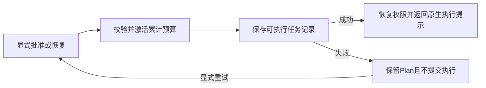

# Gemini Ultra CLI 执行状态保存与权限交接

日期：2026-11-12。WI-126 / E-307至308 /
F-086。持续目标active。源码优先，Windows必要定向验证，功能收敛后才统一最终平台打包。全局安装仍preview.83，本阶段没有打包、重装、版本变化或跨平台CI。

## 修复内容

F-086：Teamwork
approve及已批准Teamwork/Boost的resume原先在保存ready/approved任务记录之前恢复原权限。任务文件写入失败时，命令虽报错、不返回执行提示，但会提前退出Plan模式。旧实现3个存储故障复现均失败。

现在共用执行路径先保存可执行记录，再恢复权限，最后返回run_agent_workflow提示。未批准访谈resume仍先保存scoping再进入Plan并返回访谈提示；Grill
me
finish的已修复路径保持。本轮只调整执行路径的权限恢复顺序，不改变预算限额、累计记账、审批条件或自动重试策略。

同进程保存失败时，原ready未批准草案或blocked已批准记录字节保持，Plan保持，不返回执行提示；显式重试保存成功后才恢复原权限并提交原任务ID。预算激活发生在记录保存前，失败时不回滚已保存的预算激活或跨进程所有权检查点；这里没有建立跨文件事务或宣称所有文件都不变。实际执行仍要求持久化记录为ready/approved。

## 必要证据

E-307：3个新增旧复现失败，修后3个故障/显式重试场景与已有Teamwork批准、预算耗尽拒绝恢复2个相关对照共5项通过，22项不相关场景跳过。根目录`npx tsc -p packages/cli/tsconfig.json`严格类型检查和源码编译退出0；两个修改文件eslint退出0。未运行全量/冒烟或package构建脚本。

定向命令在packages/cli执行：`npx vitest run src/ui/commands/agentWorkflowCommands.test.ts --coverage.enabled=false --testNamePattern='keeps Plan permissions until|keeps teamwork scoping|updates only local cumulative limits'`。

E-308：Windows Node
v24.19.0，实际编译源码的斜杠处理器配最小UI/config适配器，对真实临时任务文件设置Windows只读属性，未mock文件系统。Teamwork
approve、Teamwork resume、Boost
resume三组均实际触发EPERM：不提交提示、Plan及原任务字节保持、临时写入文件清理、累计计数保持1。解除只读后显式重试，ready/approved保存、原任务ID的原生执行提示返回、权限只恢复一次、累计计数仍1。三组各9个条件通过，5147ms，进程退出0。计数1为本地预算记账；返回提示仅检查，未调度模型。

证据根：C:/Users/Administrator/Documents/ChatGPT/gmncliu。workflow-execution-save-before.log/-junit.xml、workflow-execution-save.log/-junit.xml、workflow-execution-save-source-compile.log、workflow-execution-save-lint.log、verify-source-workflow-execution-save.mjs、source-workflow-execution-save-result.json、source-workflow-execution-save.log。隔离辅助脚本不随包分发，Windows只读语义不当作POSIX权限验收。

## 接续边界

沿用work/gemini-ultra-agent-20261110/scope.md的R26自有源码范围，lead/cae/doc由当前会话承担。没有付费调用、旧真实任务重跑、外部安全目标、原生逆向工具执行或个人数据库修改。个人locale/provider
SHA保持4fcce506592e55074156cab2f5fea35cce0d48ea5f8c919b69cd71ffc735f2c8 /
e0bff750cd1f18458cffc175ad3683d1851bbc58958fb4182dd15d9e128e4332，个人ultra-tools.json仍不存在。

这是同进程记录保存故障与恢复验证，不是完整终端UI、跨进程故障事务、真实模型语义质量或最终平台验收。持续目标未完成；继续源码功能与恢复闭环收敛，最后统一Windows交付及macOS/Linux分发。隔离codex分支同步带skip
ci，不合并master或正式Release。
