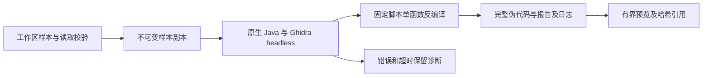

# Gemini Ultra CLI 原生 Ghidra 反编译交接

日期：2026-11-11。WI-070，本机双命令已安装preview.40，产品源1801fe128b340fda722f0c5e8d8e7d44098bd1f9。沿用自有源码case
scope，R26/code-audit接入，R22/ghidra-reverse执行生成样本静态分析；lead/cae/doc由本会话承担。不执行样本或外部目标，不改本机工具安装和个人模型配置。

## E-153 实现与证据

新增
`binary_decompile`，原生工具注册、计划模式/只读策略、researcher/reviewer/redteam-analyst等只读成员可用。当前导出一个本地函数，使用标准Ghidra发行版和兼容JDK；通过
`GEMINI_ULTRA_GHIDRA_HOME`
或标准analyzeHeadless路径定位安装，Java来自GEMINI_ULTRA_TOOL_JAVA/JAVA_HOME/PATH。`/drill setup`增加Ghidra反编译依赖发现与配置说明。

直接用Java运行Ghidra官方headless入口和固定内置Java脚本，不将文件名/地址插入shell、批处理或Java源码。工作区读取校验后复制样本到本次临时目录，分析项目、设置及缓存都在其中，不加载个人Ghidra配置。64MiB样本、1GiB
Java堆、2CPU、60秒自动分析、30秒单函数反编译、120秒进程及4MiB/输出流界限；不执行或写回原样本。失败/取消不伪造完整结果，保留analysis.log，回收仅本次临时项目。

输入filePath、可选十六进制虚拟address、maxChars(1000至60000，默认20000)。无地址选择入口或首个函数；显式地址找不到不会偷偷选另一函数。结果包括函数名/地址、imageBase、语言/编译器、原样本SHA、伪代码SHA、是否截断及工件位置。完整C式伪代码存入项目临时目录decompilations/ID/decompiled.c，report.json与analysis.log保留，预览截断不影响完整工件。不是原始源码、全程序证明或动态验证；Ghidra未恢复的原始类型/ABI需结合指令判断。

本机按tool-index实查Ghidra12.1.4与JDK21。生成无运行行为的C校验函数，用本机LLVM生成x86-64
ELF，仅静态分析。Ghidra实际还原长度8的分支、初值0x51、循环内乘0x21再XOR、比较0x13579bdf及0x2a返回，原样本SHA保持。首次PIE样本显式地址因默认重定位未找到函数，原错误日志保留；补充包含Ghidra
imageBase的诊断，后用明确布局的非PIE样本核实。不能把r2地址、文件偏移和Ghidra重定位地址混用。

4项必要边界用例通过：字面Java
argv/样本复制/完整工件与预览截断、表达式及工作区越界拒绝、Java退出0但脚本失败/分析超时不算完成、预取消/缺原生JDK不启动。严格相关lint、core/CLI类型构建通过。最后只补临时目录在工件创建失败/日志失败时仍回收的finally结构，重查同4项；不做全量/冒烟。

源码bundle真实CLI链退出0，3个loopback请求/15281ms：binary_decompile使用原生Ghidra，随后read_file读完整工件并结束。生成的512字节ELF包含一个入口调用和57字节循环/分支函数；未执行目标。SHA与完整伪代码工件一致，日志/报告/完整伪代码已复制到工程证据目录。模型响应是fixture，不是真实模型自主理解或完整Agent上线验收。

Evidence→Finding→Path：用户要求可分发的逆向Agent → WI-056/WI-070 →
E-153 实际Ghidra单函数反编译/工件哈希/CLI读回。源码与工具接线可复现，不将仅反汇编称为反编译。

工程目录 C:\Users\Administrator\Documents\ChatGPT\gmncliu：decompile-sample.c、literal
&
decompile-sample.elf、binary-decompile-source-result.json、decompile-source-artifacts；binary-decompile-cli-source.json及-output.txt、-artifacts；binary-decompile-final-test.log/junit、binary-decompile-final-types.log、binary-decompile-final-lint.log。原PIE失败binary-decompile-source.log和对应analysis.log保留。

## 分发与剩余目标

定向42914177196完成：官方Gradle :Decompiler:buildNatives在macOS
arm64成功，2m4s/6任务；同一a893844候选旧包实际反编译链21520ms、3个loopback请求、退出0，样本/完整伪代码hash及循环分支检查通过。确认缺原生组件这一根因，而不是通过改预期掩盖失败。证据ghidra-macos-native-42914177196/decompile.json、decompile-artifacts与native-build.log。补齐原生依赖检测/错误摘要/失败工件留存后，最终同源候选再由三平台包核对。

F-042：首次候选运行42912878896的Windows/Linux原生反编译通过，macOS导入/分析/脚本成功但未生成结果。保留失败日志的fixture补齐后，仅复用该macOS包在42913639623诊断，实证官方通用包缺失os/mac_arm_64/decompile。官方GettingStarted.md的Building
Native Components明确需用户构建macOS/Linux
ARM组件；不是地址或路径别名问题。新增原生组件存在/可执行检查，覆盖build/os及os目录；/drill
setup不再仅凭Utility.jar和Java宣称就绪。缺组件返回官方support/gradle的:Decompiler:buildNatives方法，工具不擅自修改本机安装。实际调用失败会摘要关键ERROR/Exception行并保留完整日志；fixture失败时也保留原生analysis.log。

定向诊断提交在既有codex/ultra-agent-native-analysis分支，以私有Git
index构建，未改本地source
index或master。42914177196复用同一旧macOS包和固定hash官方工具，仅在runner临时目录按官方Gradle任务构建Decompiler原生组件后再执行原链；不重建Windows/Linux，不重复真实付费任务。最终候选待该原因修复核实后生成。

preview.40准备三平台最终包原生验证。官方Ghidra12.1.4包ghidra_12.1.4_PUBLIC_20260921.zip，发布API
digest为ddac49f903da9d5bac833e5cc79395098b9c33cfd3279be5f31bd00387d2d4db；CI先核对hash，再临时解压，Java21由setup-java固定主版本提供。工具不随CLI分发，也不安装进用户电脑；其他电脑需独立配置工具与模型。用户产品说明位于docs/ultra-install.md，包含新反编译及已交付的成员选模/工作树用法。

WI-070本地实现完成，跨平台及本机最终安装待核对。更复杂格式/大样本、多函数关联及动态逆向仍未验收，WI-056继续；WI-054真实供应商完整自主交付与引用准确性仍未完成，不重复原付费任务。整体goal
active，只codex隔离分支、不合并master/正式Release。

## E-154 三平台最终包

[运行42914813529](https://github.com/emstudio010-hub/gemini-ultra-cli/actions/runs/42914813529)
completed/success，产品源1801fe128b340fda722f0c5e8d8e7d44098bd1f9。三个包版本/SHA、源码运行身份、安装报告、六rg二进制hash及Unix权限核对通过。同源既有Swarm/工作流多模型两入口、预算与恢复、工作树保护链全部通过。

| 平台        | 包SHA-256                                                        | 原生反编译链            |
| ----------- | ---------------------------------------------------------------- | ----------------------- |
| Windows x64 | 3985d423b1f0a01f128fb248a36e1f9a3c5060e45cd53b1f02b3786e048ebe59 | 18469ms / 3请求 / 退出0 |
| Linux x64   | 87728269df2de3e19396f35923213e01cdd8a0ada10b332f606f333a534c21a3 | 13826ms / 3请求 / 退出0 |
| macOS arm64 | a077c02e8c46c6a0f07c1898e867f5c2b84531ae43d412bf07c098466e14a62c | 14978ms / 3请求 / 退出0 |

每平台实际安装CLI调用原生Ghidra12.1.4/JDK21，反编译同一生成x86-64
ELF的0x400090函数，再通过read_file读取完整工件。循环、0x51/0x21/0x13579bdf/0x2a及条件返回观察均通过；样本未运行/未变，报告/完整C/log均随工件留存。输入SHA均44900c63dad5a5178be8069f7a5519a7afc017198172a0a5ec315dfb226c1222。Windows完整伪代码SHA244936bbdccd1bdea1b6b3a3a1d0b629aba57baef27433042b5e8bb6ae5d06dd，Unix13ef48846222940a0089b413e4fee3527b5d672617279fdc821b106ade07923f；按各自实际字节核对，不因换行不同强制伪造一致hash。macOS官方原生组件构建2m20s/6任务成功，构建日志随包报告留存。

时长仅为fixture/工具链，不用作跨平台性能比较。生成ELF在macOS上是跨目标静态解析，不代表执行它或涵盖所有二进制格式，也不是付费模型自主理解验收。

## E-155 本机安装

一次offline已有缓存安装7101ms/退出0；gemini-ultra和gemini-ultra-cli均1.0.0-preview.40，424包内文件逐一匹配Windows
CI包。入口SHA27dc398e7dfa5ecc17a01a8821edd1f52db19d3069e3fe9064534a98519f721f；旧preview.39包保留。安装辅助脚本初次误调用preview39校验器，因旧chunk缺失失败；只修正校验器引用并对已安装文件重新核对通过，未重新安装或重跑相同fixture。原失败输出保留，不将其当产品缺包。

个人模型配置/数据库及Ghidra/JDK安装未改；不自动跑真实模型或旧付费审查。其他电脑需按产品说明独立配置工具；macOS/Linux
ARM需先准备Ghidra对应原生组件，CLI已明确检测。

工程证据：github-preview40-run.json、github-preview40-artifacts-result.json、github-run-42914813529各平台decompile-verification.json/-output.txt/-artifacts及macOS
decompile-native-build.log；global-preview40-install-result.json、global-install-github-preview40-full-result.json。交接源码/工程/Obsidian同步。

WI-070交付。WI-056仍需更复杂格式、多函数关联与动态逆向实际验收，WI-054真实供应商无人介入完整交付/引用准确性未完成。goal
active，仅codex分支，不合并master、不正式Release。后续集中真实交付及能力缺口，不无止境新增小测试或重复原付费任务。
