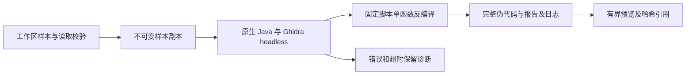

# Gemini Ultra CLI 原生 Ghidra 反编译交接

日期：2026-11-11。WI-070，候选preview.40；本机当前preview.39。沿用自有源码case
scope，R26/code-audit接入，R22/ghidra-reverse执行生成样本静态分析；lead/cae/doc由本会话承担。不执行样本或外部目标，不改本机工具安装和个人模型配置。

## E-153 实现与证据

新增
`binary_decompile`，原生工具注册、计划模式/只读策略、researcher/reviewer/redteam-analyst等只读成员可用。当前导出一个本地函数，使用标准Ghidra发行版和兼容JDK；通过
`GEMINI_ULTRA_GHIDRA_HOME`
或标准analyzeHeadless路径定位安装，Java来自GEMINI_ULTRA_TOOL_JAVA/JAVA_HOME/PATH。`/drill setup`增加Ghidra反编译依赖发现与配置说明。

直接用Java运行Ghidra官方headless入口和固定内置Java脚本，不将文件名/地址插入shell、批处理或Java源码。工作区读取校验后复制样本到本次临时目录，分析项目、设置及缓存都在其中，不加载个人Ghidra配置。64MiB样本、1GiB
Java堆、2CPU、60秒自动分析、30秒单函数反编译、120秒进程及4MiB/输出流界限；不执行或写回原样本。失败/取消不伪造完整结果，保留analysis.log，回收仅本次临时项目。

输入filePath、可选十六进制虚拟address、maxChars(1000至60000，默认20000)。无地址选择入口或首个函数；显式地址找不到不会偷偷选另一函数。结果包括函数名/地址、imageBase、语言/编译器、原样本SHA、伪代码SHA、是否截断及工件位置。完整C式伪代码存入项目临时目录decompilations/ID/decompiled.c，report.json与analysis.log保留，预览截断不影响完整工件。不是原始源码、全程序证明或动态验证；Ghidra未恢复的原始类型/ABI需结合指令判断。

本机按tool-index实查Ghidra12.1.4与JDK21。生成无运行行为的C校验函数，用本机LLVM生成x86-64
ELF，仅静态分析。Ghidra实际还原长度8的分支、初值0x51、循环内乘0x21再XOR、比较0x13579bdf及0x2a返回，原样本SHA保持。首次PIE样本显式地址因默认重定位未找到函数，原错误日志保留；补充包含Ghidra
imageBase的诊断，后用明确布局的非PIE样本核实。不能把r2地址、文件偏移和Ghidra重定位地址混用。

4项必要边界用例通过：字面Java
argv/样本复制/完整工件与预览截断、表达式及工作区越界拒绝、Java退出0但脚本失败/分析超时不算完成、预取消/缺原生JDK不启动。严格相关lint、core/CLI类型构建通过。最后只补临时目录在工件创建失败/日志失败时仍回收的finally结构，重查同4项；不做全量/冒烟。

源码bundle真实CLI链退出0，3个loopback请求/15281ms：binary_decompile使用原生Ghidra，随后read_file读完整工件并结束。生成的512字节ELF包含一个入口调用和57字节循环/分支函数；未执行目标。SHA与完整伪代码工件一致，日志/报告/完整伪代码已复制到工程证据目录。模型响应是fixture，不是真实模型自主理解或完整Agent上线验收。

Evidence→Finding→Path：用户要求可分发的逆向Agent → WI-056/WI-070 →
E-153 实际Ghidra单函数反编译/工件哈希/CLI读回。源码与工具接线可复现，不将仅反汇编称为反编译。

工程目录 C:\Users\Administrator\Documents\ChatGPT\gmncliu：decompile-sample.c、literal
&
decompile-sample.elf、binary-decompile-source-result.json、decompile-source-artifacts；binary-decompile-cli-source.json及-output.txt、-artifacts；binary-decompile-final-test.log/junit、binary-decompile-final-types.log、binary-decompile-final-lint.log。原PIE失败binary-decompile-source.log和对应analysis.log保留。

## 分发与剩余目标

preview.40准备三平台最终包原生验证。官方Ghidra12.1.4包ghidra_12.1.4_PUBLIC_20260921.zip，发布API
digest为ddac49f903da9d5bac833e5cc79395098b9c33cfd3279be5f31bd00387d2d4db；CI先核对hash，再临时解压，Java21由setup-java固定主版本提供。工具不随CLI分发，也不安装进用户电脑；其他电脑需独立配置工具与模型。用户产品说明位于docs/ultra-install.md，包含新反编译及已交付的成员选模/工作树用法。

WI-070本地实现完成，跨平台及本机最终安装待核对。更复杂格式/大样本、多函数关联及动态逆向仍未验收，WI-056继续；WI-054真实供应商完整自主交付与引用准确性仍未完成，不重复原付费任务。整体goal
active，只codex隔离分支、不合并master/正式Release。
