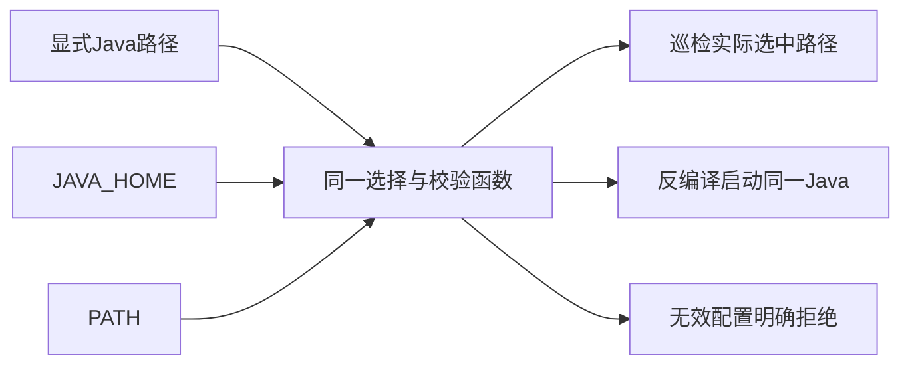

# Gemini Ultra CLI Ghidra Java 选择一致性交接

日期：2026-11-11。WI-083/E-189/F-051，候选 preview.51。沿用 R26/code-audit 自有源码 case、lead/cae/doc，Ghidra 原生静态链沿用 R22 与既有 scope。没有外部安全目标或付费模型调用，不修改个人配置、数据库和本机工具安装。

## 问题与修复

E-189：已安装 preview.50 的实际 `/drill preflight`
在 JAVA_HOME 指向不存在目录、PATH 仍有 Java 时，显示 Java 和 Ghidra
decompiler 均 ready。源码执行端却优先使用 JAVA_HOME，因此巡检与实际运行不一致。旧实现新增5项定向场景4失败/1通过，覆盖错误 JAVA_HOME、错误显式覆盖被有效 JAVA_HOME 掩盖、有效 JAVA_HOME 被 PATH 抢先，以及把批处理包装报告为就绪。

安装版复现脚本在首次巡检断言失败，未进入后续 Ghidra 反编译流程。工程保留
`java-discovery-installed50-before.log` 与
`java-discovery-installed50-before-java-discovery-output.txt`；没有为失败记录生成成功 JSON。

新增共享 `discoverGhidraJava`，巡检和反编译统一使用：

1. 非空 `GEMINI_ULTRA_TOOL_JAVA`。
2. 非空 `JAVA_HOME` 下的 bin/java（Windows 为 java.exe）。
3. 只有两者均未指定时才使用 PATH。

高优先级选择无效时明确给出变量与实际路径，不能被其他 Java 掩盖。统一检查文件和执行权限，拒绝批处理包装，使用绝对路径，保留空格。反编译在建立分析工件及启动 JVM 前拒绝无效路径。文件存在仍不等于 JDK 版本兼容，后者继续在实际使用时判断。

Evidence → Finding → Path：E-189 安装版实际巡检与源码优先级差异 →
F-051 就绪状态掩盖将被执行端选中的无效 Java → 共享选择与校验 →
10项相关定向检查及实际包 Ghidra 链。没有为其他工具添加回退，也不自动安装或更改 JDK。

## 验证与分发

修复后5项巡检场景加5项反编译相关检查，共10项通过；覆盖执行端无效选择不启动 JVM、不建立分析工件、不改样本。相关严格 lint/type 退出0。未运行全量、冒烟或付费任务。

工程证据目录 C:\Users\Administrator\Documents\ChatGPT\gmncliu：`java-discovery-before-junit.xml`、`java-discovery-before.log`、`java-discovery-junit.xml`、`java-discovery-test.log`、`java-discovery-types.log`、`java-discovery-lint.log`、`java-discovery-final-lint.log`。

候选51使用 ghidra-runtime 范围：三平台新鲜包/安装；每平台三次本地巡检，分别核对坏 JAVA_HOME、坏显式覆盖、有效覆盖优先于坏 JAVA_HOME，均不得请求模型；随后使用真实 Ghidra/JDK 静态反编译既有生成 ELF 的循环分支函数，读取并校验完整工件。既有样本不执行，不把 loopback 模型当真实模型自主逆向验收。

最终源码、CI 和安装结果待本阶段追加。未受影响协作基线47、供应商48、长报告49、完成提交修正和命令语言50保留，不冒充本版本重新验收。goal
active，真实 Teamwork 长任务、更多模型、摘要准确性、复杂格式/多函数/动态逆向与跨机器实际交互继续；不合并 master 或创建正式 Release。
