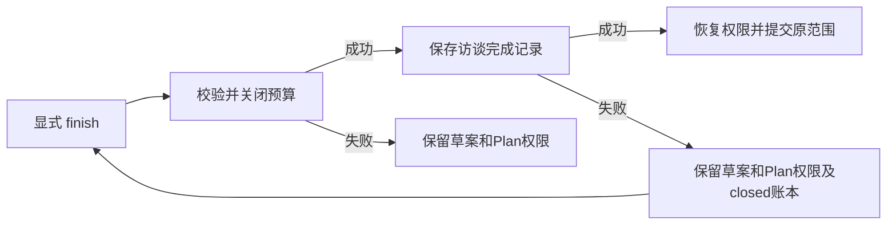

# Gemini Ultra CLI Grill me 完成状态交接

日期：2026-11-12。WI-123 / E-302至303 /
F-083。持续目标 active。开发顺序保持源码完善、Windows必要定向验证，最后统一打包；本轮未打包、全局重装、变更版本或运行跨平台CI。全局安装仍preview.83，本轮修复仅在源码及本地编译产物。

## 问题与修复

F-083：`/grill-me finish`
原先先恢复权限、保存approved/completed，再关闭累计预算。另一个仍存活的CLI拥有预算、账本缺失/损坏或关闭写入失败时，命令报错，但权限已恢复，且前三类及关闭失败会留下虚假的完成记录。完成记录本身保存失败时也会提前恢复权限。

现在先通过现有closeWorkflowBudget读取、校验所有权并关闭账本，再保存访谈完成状态；两者成功后才恢复原权限并返回带原范围和验收条件的submit_prompt。拒绝关闭时原任务、预算、指针字节与Plan权限保持；不提交后续任务。若关闭成功但完成记录保存失败，预算保持closed、原ready草案及Plan权限保留，显式再次finish可以重试本地保存；不声称这两个文件具有跨文件原子事务。累计请求数与里程碑内容保持，完成指访谈完成，不代表后续实施交付已经完成。Teamwork批准路径的原顺序保持。

## Windows证据

E-302：旧实现三个所有权/账本场景复现失败；存储故障观察器首用ESM namespace
spy不可配置，第二版mock未拦截已加载core，均保留日志。改用默认fs对象与syncBuiltinESMExports后，两个存储故障旧复现也实际失败。修后5个新增场景及2个直接相关的Teamwork审批/访谈取消对照，共7项通过，12项未相关场景跳过。没有全量或冒烟检查。

命令在packages/cli执行：`npx vitest run src/ui/commands/agentWorkflowCommands.test.ts --coverage.enabled=false --testNamePattern='keeps grill-me finish unchanged|retries grill-me finish|keeps teamwork scoping|restores permissions when cancelling'`。实际退出0，JUnit见grill-finish-junit.xml。修改的两个文件eslint退出0；`npx tsc -p packages/cli/tsconfig.json`严格类型检查及源码编译退出0，未调用package构建脚本。

E-303：Windows Node
v24.19.0实际编译后斜杠处理器，最小UI/config适配器和真实第二Node所有者进程，10807ms/退出0。所有者进程创建ready访谈并累计1请求计数（只是本地预算记账，没有模型请求），保持存活；另一进程finish被拒绝且任务目录全部文件字节/Plan权限保持。所有者自然退出0后，显式finish返回原brief/acceptance，保存completed/approved与closed账本、累计计数仍1；权限只恢复一次，重复finish不提交且记录/账本字节保持。这是处理器级双进程验证，没有重跑完整终端UI或真实模型任务。辅助脚本首因Windows动态import未转file
URL失败，修正观察器后通过，原错误日志保留；产品没有因此改动。

证据根：C:/Users/Administrator/Documents/ChatGPT/gmncliu。文件：grill-finish-before.log/-junit.xml、grill-finish-before-corrected.log/-junit.xml、grill-finish-storage-before.log/-junit.xml、grill-finish.log/-junit.xml、grill-finish-lint.log、grill-finish-source-compile.log、verify-source-grill-finish.mjs、source-grill-finish-result.json、source-grill-finish.log、source-grill-finish-initial-url-error.log。辅助脚本为隔离验证资料，不随包分发。

## 边界与接续

沿用work/gemini-ultra-agent-20261110/scope.md的R26自有源码范围，lead/cae/doc由当前会话承担。没有外部安全目标、付费模型调用、旧任务重跑、逆向工具执行或个人数据库修改。个人locale/provider
SHA保持4fcce506592e55074156cab2f5fea35cce0d48ea5f8c919b69cd71ffc735f2c8 /
e0bff750cd1f18458cffc175ad3683d1851bbc58958fb4182dd15d9e128e4332，个人ultra-tools.json仍不存在。

本轮不解决所有工作流跨文件落盘的完整事务性，也不新增全局自动恢复；真实模型长期语义质量、更多复杂逆向任务和最终平台交付仍未验收。继续检查源码恢复与取消闭环，功能收敛后才做最终Windows交付及macOS/Linux分发。隔离codex分支同步带skip
ci，不合并master或正式Release。
