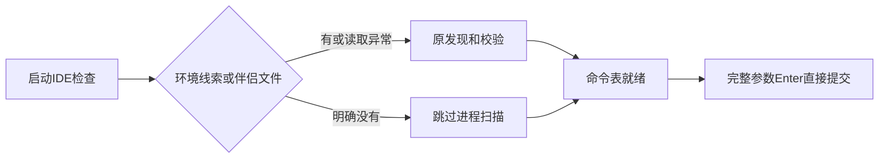

# Gemini Ultra CLI IDE 发现与完整参数提交交接

日期：2026-11-11。WI-078/E-173，preview.46候选。沿用自有源码case
R26/code-audit、lead/cae/doc；只修改本地CLI启动和输入交互，不改个人供应商配置、数据库或逆向工具，不调用付费模型。

## 问题与实际修复

前阶段原生启动计时显示内置命令加载仍约0.5至0.7秒。BuiltinCommandLoader会await
ideCommand，IdeClient.getInstance首次执行Windows全进程CIM扫描，再读伴侣连接文件；常规终端没有IDE信息时仍支付这笔开销。

当前修复在环境中没有IDE/显式PID/端口/工作区/stdio线索，且临时gemini/ide目录没有旧版或新版伴侣连接文件时，跳过进程树扫描。存在伴侣文件时保留原发现、文件所有权/PID/工作区校验；目录权限等读取错误也保留原路径，不把“读不出来”误当“没有伴侣”。不更换/ide命令的子命令或行为，原生IDE使用不假设全部不支持。

尝试过命令惰性代理但已完整撤回，未进入产品提交。过早按“无环境变量”跳过的候选已补伴侣文件保护；两个早期CI虽成功，但缺最终兼容修正/完整参数提交修复，未安装为交付包。另首轮包默认版本仍45，身份核对拒绝，随后显式改为46；保留run42936582726与run42937838265记录，不把它们当最终交付。

更快命令加载暴露输入缺陷：/effort
low已经完整输入，当前参数建议仍为low，Enter走接受建议路径、追加空格，始终没有提交。几次旧观察均40秒后被watchdog停止，passed=false，零模型；原exitCode=0来自PTY停止，不能称正常退出或成功。

当参数建议完成后的全文trim与当前输入完全一致，命令有action、用户未主动导航其他建议时，Enter直接提交当前输入。Tab仍只补全；不同/部分参数、主动选其他建议、Shift+Enter与现有autoExecute规则保持。最终源码ConPTY同类观察通过：输入框1931ms、本地命令确认2217ms、总3690ms（含按键/退出），零模型、自然/quit；旧45同类观察1917/2735ms。单次观察有缓存、编译与机器负载差异，不称稳定加速百分比或所有终端基准。

## 验证与保留记录

相关IDE三个文件110项通过、1项原有skip，涵盖普通终端无扫描、伴侣文件保留/旧新命名/权限错误、IDE连接及协议。原IdeClient测试重置了不存在的instance字段，已改为真实instancePromise，让每例独立初始化；不再把跨例单例残留当覆盖证据。InputPrompt定向9项通过，含完整参数及尾部空格、部分参数、其他建议与Shift+Enter；没有执行整个输入框测试文件。严格相关lint/type通过。

源码阶段已有26个CLI命令相关用例通过；惰性方案撤回后不以该数字证明最终方案。工程目录C:\Users\Administrator\Documents\ChatGPT\gmncliu：ide-probe-compatible-junit.xml/-test.log、ide-probe-exact-completion-final-junit.xml/-test.log、ide-probe-compatible-lint.log/-types.log、preview46-source-exact-submit-result.json/-output.txt、ide-probe-compatible-source.log。早期preview46-interactive-source/profile/slow-enter/source2原失败结果保留，不覆盖成成功。

观察脚本observe-interactive-startup.mjs已补timedOut字段与成功门控；没有为这项脚本标记重复CLI，最终安装观察再记录。辅助生成脚本曾从源码目录误读工程路径，随后改绝对路径；未改个人配置，不对失败工件执行安装。

Evidence→Finding→Path：启动阶段与BuiltinCommandLoader/IdeClient调用链 →
F-045普通终端全进程扫描、F-046完整参数Enter重复补全 →
E-173保留伴侣兼容的无扫描路径、相同参数Enter提交、原生CLI确认收尾。

## 分发与目标池

preview.46最终候选待三平台工件/身份与Windows安装一次启动观察。WI-078本地修复完成，goal
active，不合并master/正式Release。没有宣称所有电脑交互启动、文件伴侣真实IDE安装、真实远程任务、Teamwork长任务或更多模型已全部验收；最终包交付后继续原完整目标，避免仅追微小性能数字。
