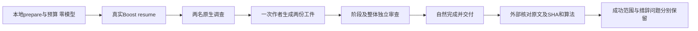

# Gemini Ultra CLI 真实 Boost 交付交接

日期：2026-11-11。WI-071/E-156，本机preview.40，产品源1801fe128b340fda722f0c5e8d8e7d44098bd1f9。本阶段未修改产品源码或升级安装。沿用自有源码case的R22/Ghidra及R26静态审查授权；lead/cae/doc本会话承担。

## 真实执行结果

一次全新真实配置供应商调用，模型deepseek/deepseek-v4.1-flash。任务为自建ELF的静态逆向报告，原C代码不提供给CLI；不是E-124的两源码审查，也不是旧八文件报告。所有配置、凭据与事实库在临时profile中隔离，原配置hash保持，不执行样本或shell、不访问外部安全目标。

从真实已安装CLI `/boost prepare <任务>` → `/boost budget 28 2 1` →
`/boost resume`
进入原生工作流。前两条本地命令均0模型请求；仅一次resume，不补提示、不替成员写报告、不重跑或增加预算。任务约定两个调查方向：原生Ghidra反编译及r2结构/指令复核；一个coder写reverse-report.md和evidence.json，阶段与最终auditor独立读文件。所有调用仍由产品原生工具和执行器完成，没有Codex子代理。

结果：410835ms（包含本地准备）、自然退出0，未超时；23次真实请求（主会话3、研究8、作者5、审查7）；任务内累计21/28调度、0失败阶段、1次实施。完整原生阶段记录为investigate
1.1/1.2、implement 1.1、review 1.1、final
audit，全部completed，两个结构化审查passed=true，工作流phase=completed。主会话自然给出LIVE_REVERSE_DELIVERED。

隔离的观察约束为low、32768输出上限、64000上下文、maxAttempts=1、28次原生调度、32次额外观察硬限、480秒外层期限、最多1次实施，不代表供应商权益或产品默认。未触及预算，未有finish_reason=length。23份响应报告395975输入/26745输出，共422720Token；是服务报告的用量，不是账单。观察器clone在收到DONE后清理时出现incompleteRead/AbortError，与历史一致，不当作真实回答中断证据。后续不自动重复本任务付费调用。

## 实际工件与独立复核

生成样本checksum.elf为自建C编译的x86-64非PIE
ELF，仅静态分析。样本SHA-256为ef632f324da0e43227f17f4a9004d09b192a937d4806204162a61c7d0daa2b90，原样本及个人供应商配置hash保持。原C不在提供给模型的工作区。

报告558个汉字，满足300至900要求；evidence.json给出完整样本SHA及6条12至180字符的连续原文引用。逐条与保留的完整decompiled.c匹配，工具report.json的样本/伪代码SHA也匹配。实际仅1次binary_decompile、2次write_file，没有run_shell_command。研究、作者及审查确实调用文件/原生工具；原始会话记录保留，工具数量为read_file13、binary_inspect11、binary_analyze5、complete_task5、binary_decompile1、write_file2、run_agent_workflow1、list_directory1。

与未提供给模型的自建C、独立LLVM反汇编及完整Ghidra伪代码核对，核心结论吻合：长度恰好8；累加器初值0x51；每轮32位乘0x21后与输入字节XOR，8轮；比较0x13579bdf，命中返回0x2a，否则返回acc&7，长度不符返回0。模型主动记录未恢复原参数/ABI、未执行样本、未分析调用方及0返回语义重叠等边界。

独立复核保留两处措辞问题：原报告称in_ESI/in_RDI“未声明”，实际已在伪代码中声明为局部变量，缺的是原参数与调用约定恢复；主会话最终摘要称伪代码书写顺序与cmovne“不符”，原报告已说明它们语义等价，不能将书写顺序差异当行为缺陷。未修改模型原始输出来伪造完全准确。这次证明核心算法/引用及有界任务交付成功，不证明所有自然语言摘要均准确。

临时profile与隔离凭据已清理，报告内原临时工件路径因此作为历史地址保留。完整字节另存工程目录，independent-review.json给出原地址→保留地址及hash映射；delivery.md提供当前可打开的报告/伪代码/报告/日志链接。保留而不静默改写模型报告中的原引用。

Evidence→Finding→Path：WI-054要求真实供应商无人介入交付与可靠引用 →
E-156真实Boost五阶段与自然收尾、完整工件、独立6条原文及SHA核对 →
WI-071有界生成样本交付通过；复杂场景、真实Swarm及更广准确性继续，不由单任务成功覆盖。

## 证据与接续

工程根 C:\Users\Administrator\Documents\ChatGPT\gmncliu：

- preview40-live-boost-reverse-result.json、-requests.jsonl、-wire.jsonl、-output.txt、-run.log：真实任务、用量和阶段原始记录，已脱敏。
- preview40-live-boost-reverse-workspace/：原始报告、evidence.json、样本。
- preview40-live-boost-reverse-records/：完整阶段/会话及Ghidra的C、report.json、analysis.log。
- preview40-live-boost-reverse-independent-review.json、-delivery.md：独立核对结果、地址映射和可用交付链接。
- verify-live-boost40.mjs、bound-live-boost40.mjs、review-live-boost40.mjs：一次运行、预算观察和对已有记录复核，不作为付费重跑入口推荐给用户。

WI-071交付。WI-054现有一个真实Boost、生成样本、单里程碑的成功实例；E-124真实Swarm失败及旧任务历史保留，不改成通过。Teamwork/Swarm真实供应商长任务、更多模型、复杂多函数/格式和动态逆向尚未验收；整体goal
active，不合并master、不正式Release。

性能上，这个57字节函数交付仍消耗约6分51秒及422720报告Token，不能称为高效。下一步应根据现有阶段/请求证据削减重复上下文与不必要的证据重复读取，保留独立审查门控；不通过重复付费同样任务来追数字。继续保持必要检查与明确边界。
