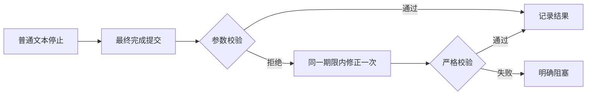

# Gemini Ultra CLI 原生命令语言与完成提交恢复交接

日期：2026-11-11。WI-082，preview.50 已安装。沿用 R26/code-audit 自有源码 case，lead/cae/doc，scope
granted；case-guard 退出0。没有外部扫描、个人配置/数据库或逆向工具安装改动。

## 真实任务结果与修复

E-185：已安装 preview.49 原生 Teamwork 在隔离 Git 快照上执行三个实际命令的本地化任务。草案保存两个里程碑，显式批准前没有实施。实际运行131737ms、15个真实请求（主协调9、researcher6、coder0），最终 blocked，三个快照源文件字节未变。researcher 在普通文本结束后的最终提交中，把 wait_for_previous 放入 result 对象，严格校验拒绝额外字段；最后回合没有机会根据错误修正，报 ERROR_NO_COMPLETE_TASK_CALL。没有生成交付补丁，不能算 Teamwork 成功交付。

模型响应报告158638输入、7269输出、合计165907
token，非账单。隔离凭据已移除，工作树与原始请求/响应保留。没有重复付费任务。后续实际源码的文案修改由宿主完成，不能归功于失败的 Teamwork。

E-186/F-050：最终提交参数被拒绝后没有修正机会。local-executor 仅对 ERROR_NO_COMPLETE_TASK_CALL 的 grace 提交参数解析失败或 INVALID_TOOL_PARAMS，允许一次 completion-only 修正，复用同一个60秒 signal/期限且遵守原工作流预算。禁止工作工具，不放宽 schema，不剥离字段，失败不循环。MAX_TURNS/TIMEOUT 不获得此修正，达到执行上限仍保留失败语义。

同时，team/redteam 的描述使用当前语言动态 getter；drill 主/子命令说明和打开、关闭、状态、巡检、授权、事实、错误反馈随语言变化。事实正文、路径、哈希、状态和时间等原始数据保持，权限、并发、授权及数据库调用逻辑不变。状态计数明确为当前查询返回数量。

Evidence → Finding → Path：E-185 实际拒绝记录及源码调用链 →
F-050 最终提交校验失败后立即退出 →
E-186 一次有界修正、严格校验和命令语言实现 → 定向与原生链证据。原始失败永久保留，不被离线链替代。

## 验证

旧实现先复现恢复用例失败；修复后 Recovery Turns
15项通过、65项未运行。命令语言旧实现3失败/1保护通过，修复后4项通过。总19项定向检查，相关严格 lint/type 退出0，不跑全量或冒烟。

源码原生链：12条本地命令，10条退出0、2条预期退出42、0模型请求，覆盖中英文、中文别名、授权门和错误；completion-repair 模式16个 loopback 请求、14任务调度、五阶段完成/退出0，两个调查成员先提交错误参数，再接收校验反馈修正。不是实际供应商质量验收。源码报告版本取上游 nightly 元数据，最终包身份另核对。

证据目录：C:\Users\Administrator\Documents\ChatGPT\gmncliu。真实记录前缀 preview49-live-teamwork-localization-；定向记录 completion-repair-before、completion-repair-test、completion-repair-junit.xml、native-command-locale-before、native-command-locale-test、native-command-locale-junit.xml；严格检查 native-command-completion-final-_
和 native-command-repair-script-lint.log；原生源码 native-command-source._、completion-repair-source.\*。

## 分发与剩余边界

候选50使用 agent-localization 范围，只运行三平台新鲜打包/安装、本地语言命令与完成参数恢复链；未受影响的 Swarm/Teamwork/Ghidra 完整基线为47/run43018021899，供应商为48/run43024019734，长报告为49/run43026662717。不把跳过的步骤称作本版本重新验收。

E-187：最终产品源 `5a5697564c443d97c0430c32826ef4c230691434`，
[run 43032286756](https://github.com/emstudio010-hub/gemini-ultra-cli/actions/runs/43032286756)
三平台 completed/success，agent-localization 范围。版本/源码身份/包 SHA、六份 rg 哈希及执行权限、安装与4个基础工具均核对通过。每平台12条本地命令、10退出0/2预期42/0模型请求；完成参数修正链16个 loopback 请求、14调度、五阶段 completed、全部 checks 通过，旧链步骤 skipped。

E-188：Windows
CI 包 offline 已有缓存安装7785ms/退出0，双命令 preview.50，425文件逐一匹配包；旧包保留。包 SHA256 为
`50e2e08e78f9c0540e8ca314088532559378afb49ff809c3de2b27add809f59b`，入口 SHA256 为
`6d3655dfbe5c002fc7f84527cd9471c2c8229bcb9121c812e629e406834e7635`。首次宿主安装脚本使用 Windows
PowerShell 默认编码读取含中文 JSON 而失败，尚未执行 npm；明确 UTF-8 后安装成功，不是产品故障，也没有重跑业务链或付费任务。

最终证据：`github-preview50-run.json`、`github-preview50-artifacts-result.json`、`github-run-43032286756/`、`global-preview50-install-result.json`、`global-install-github-preview50-full-result.json`。源码、工程正式报告和 Obsidian 交接同步。WI-082修复与分发交付，E-185实际失败保持。

goal
active；真实 Teamwork 自主长任务成功、更多模型、长会话摘要准确性、复杂逆向及跨机器实际交互仍未完成。不合并 master，不创建正式 Release。
