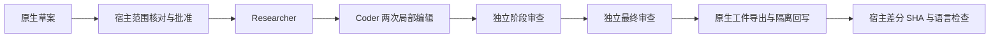

# Gemini Ultra CLI 原生 Teamwork 本地化交付交接

日期：2026-11-11。WI-090/E-212，候选preview.58。沿用R26/code-audit自有源码case、lead/cae/doc，scope授权granted。一次新真实任务，不是旧本地化/恢复任务重跑；无外部安全目标、Codex子代理或个人配置/数据库/逆向工具改动。

## 原生真实任务与实现归属

已安装57使用当前deepseek/deepseek-v4.1-flash，对actual
agentTaskLock.ts的隔离Git快照实施单里程碑：ELOCKED提示通过现有I18nManager按当前语言构造，中文为“另一个 CLI 正在更新 Agent 任务状态，请在更新完成后重试该命令。”，英文保持原字节。I18nManager.ts只读参考；锁参数/重入/释放/非ELOCKED错误与Error
cause不变。提供read_file/replace等实际工具，禁止shell、测试、外部探测和额外文件改动。

prepare→budget24/失败2/实施轮1→workspace
on均零模型。需求草案3真实请求、approved=false/0实施。宿主逐条审查，只澄清brief的一句矛盾措辞：允许现有I18n
API读取偏好，不允许直接读写locale文件或set/change；保留原model
draft和校正记录，校正后仍未批准，再用独立host gate显式/teamwork
approve。接受标准和预算未降低，模型没有自批。

E-212完成：318847ms、24真实请求，无宿主超时；main7/researcher4/coder5/workflow-auditor8。调查、实施、独立阶段审查、独立最终审查四份报告及单里程碑均完成，两个结构化verdict
passed。coder实际两次replace、0次write_file，只加I18n导入和内联t(zh,en)包装。宿主读实际补丁，git
apply
--check后接受，实际源SHA与原生工作树相同；这部分生产代码由原生Teamwork完成，后续宿主检查/分发代码单独归属。

原生工作树完成export/apply到隔离源快照，用户的暂存/未暂存/未跟踪示例与index/HEAD保留，参考及SPEC字节保持。个人供应商文件SHA前后一致，临时凭据文件已删除。24条响应均200，模型报告295359输入+19046输出=314405
token，非账单；不同于旧任务范围，不作成本/速度对比。E-185/E-198旧失败原样保留，不增加预算或自动重试。

原生审查明确静态限定且未运行测试/VCS/hash；单文件范围与其他文件字节保持的独立证明来自宿主git/SHA。coder自由文字仍写awaiting
approval，但实际已由宿主批准且流程completed，以状态/工具和工件为准，不把自由文字当状态。一次小型真实交付不证明任意长任务或所有模型的质量。

Evidence → Finding →
Path：安装57真实Teamwork草案/四阶段/两个replace/工件 → 固定英文忙碌提示缺当前语言 → 原生实现内联I18n/Error
cause保留 → 宿主真实锁语言切换/三平台安装命令检查。

## 验证与限制

宿主仅新增1项实际文件锁检查：旧实现中文断言先失败；修后同一进程en→zh→en，提示即时切换，原ELOCKED
cause保留，落败action不执行且原锁仍存在。locale文件严格指向临时目录，最后恢复临时实例偏好再撤销环境变量；本机locale
SHA保持57末值。相关严格type/lint通过，没有全量/冒烟或重复付费任务。

源码中文原生链通过：3次CLI进程（一次目录初始化、两竞争），一方0/一方预期42，仅一记录和正确绑定，落败方实际输出精确中文提示，原锁已释放，0模型。源码报告版本来自上游nightly根包。三平台包/安装结果待追加；既有57三平台三组英文竞争/注册锁基线保留。工程目录C:\Users\Administrator\Documents\ChatGPT\gmncliu：preview57-live-teamwork-lock-locale-_、run-live-teamwork57.mjs、approve-live-teamwork57.mjs、review-live-teamwork57.mjs、task-lock-locale-before_、task-lock-locale-junit.xml、task-lock-locale.log、task-lock-locale-types.log、task-lock-locale-lint.log、task-lock-locale-source\*。临时任务profile和原始报告保留，未写入真实项目的全局任务目录。

goal
active。真实Teamwork已有这一次有界交付，更多模型/长任务、报告状态口吻、恢复/取消交错、长会话语义准确性与复杂跨机逆向继续。不合并master或创建正式Release。
