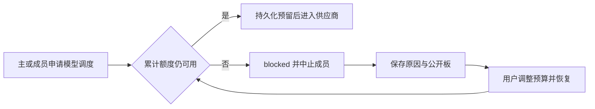

# Gemini Ultra CLI Swarm 原生预算交接

日期：2026-11-11。候选 preview.33；本机安装此时仍 preview.32。

## E-128 / F-034：提示词没有执行预算

E-124 真实任务中作者进入第三轮，超过约定的一轮修正；观察者主动停止，任务没有交付。仅保留具体错误（E-125/127）不能阻止协调者再次唤醒。此阶段将限制落到运行时，不重复同一付费任务。

Swarm 默认累计限制：120 次模型调度、2 次失败轮次、40 次成员唤醒；原有每成员 20 轮及每轮 10 分钟上限保留。失败轮次包括执行失败和未通过的独立审查；2 次失败不是允许重试 2 次。所有成员共用额度，改名、移除、取消或恢复不清零。旧记录迁移已有成员轮数和仍保留的失败状态；历史模型调用总数不可还原，不伪造旧用量。

`UniversalContentGenerator`
在交给外部协议或原生 fallback 之前预留模型调度次数，同一拥有进程的主 Agent、子成员、压缩等辅助生成共用额度；成员上下文通过运行时身份传递。应用层重新调用也再次计数。此数字是保守的调度上限，**不是 Token、费用或供应商 SDK 内部 HTTP 重试总数**；取消的惰性流也可能已经预留额度。其他独立 CLI 进程不使用本任务额度，显式恢复会先接管已退出的旧拥有进程。

触限保持 `blocked` 和成员
`paused`，中止其他已发起成员、禁止新生成及完成。最后一次合法生成可正常完成；只有再申请超额调度时才阻断。默认失败额度耗尽立即受阻。请求/总轮数上限不替代已有的当前独立 verdict 完成门控。

用户本地命令 `/swarm budget 160 3 50`
修改累计上限；不会调用模型，不提供给模型的工具。`/swarm status` 与 `board`
显示计数及原因。提高已耗尽额度后
`/swarm resume`；恢复不自动唤醒失败成员，继续需要明确提及。`/swarm cancel`
释放本会话的生成限制并保留原记录；再次恢复旧任务仍检查已花额度。数字输入与上限严格校验。

## 定向验证

- 17 个 core 用例通过：其中原 Swarm/错误交接 6 项，新预算相关 11 项；覆盖跨成员失败额度、旧记录迁移、累计唤醒、同伴取消、成员运行时身份、六条外部协议流/非流路径、主会话与辅助 fallback 共用额度、超额错误不可重试及取消后普通生成恢复。
- 2 个 CLI 用例通过：本地数字命令/拒绝非法输入，以及已有看板渲染、刷新、控制符剥离和 Esc。
- 受影响严格 lint、core/CLI 类型构建通过。仅必要检查，没有全量/冒烟或新付费模型请求。
- 源码 bundle 实际执行原生成员及模拟输出上限：总 3 个 loopback 请求，其中第 1 个用于创建隔离状态，后 2 个计入任务预算；下一次生成在供应商之前被拒绝。CLI 自行退出 1，任务 blocked、作者 paused/1 轮、具体输出上限诊断保留，无工件、无伪造完成。辅助脚本退出 0 表示这些失败边界符合预期，不能称任务交付成功。

工程目录证据：`swarm-budget-core.log`、`swarm-budget-core-junit.xml`、`swarm-budget-cli.log`、`swarm-budget-cli-junit.xml`、`swarm-budget-types.log`、`swarm-budget-lint.log`、`swarm-budget-source-result.json`
及输出。源码 bundle 结果不代替最终 CI 包和全局安装身份核对。

Evidence→Finding→Path：E-124 越过自然语言修正约定 →
F-034 仅每名字硬限额且缺任务累计预算 →
E-128 持久化累计额度、共享生成入口、blocked/中止及本地恢复命令。

## 接续边界

此阶段实现 Swarm 任务级限额。Teamwork/Boost 仍沿用原生每里程碑两轮实施审查及 20 分钟限制，尚没有独立任务请求累计预算；不扩大为所有工作流已统一计费控制。任意自然语言约束不会自动解析为数值预算。成员独立模型、隔离 Git
worktree、真实供应商完整自主交付/引用可靠性和复杂反编译仍未完成。目标保持 active，不合并 master、不发布正式 Release。
