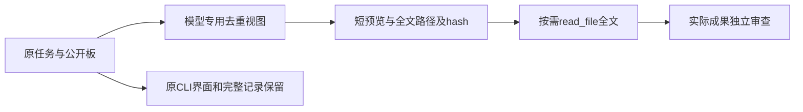

# Gemini Ultra CLI Swarm 上下文精简交接

日期：2026-11-11。WI-075/E-164至166，preview.43已安装。沿用自有源码case、R26/code-audit、lead/cae/doc；只修改本地Agent上下文与分发核对，不改个人供应商配置、数据库或逆向工具。

## 问题与修复

E-163真实Swarm成功交付代码，但23请求报告581456Token（非账单），已有上下文压缩活动。源码确认目标、公开职责、成员结果被状态快照和自动板记录重复注入。原模型状态视图还只给结果前2000字符，没有明确标记省略。

新增swarmContext.ts，模型专用视图与原CLI/UI
snapshot分开。保留目标、全部成员状态、轮次、累计预算、失败诊断、revision/verifiedRevision和工作树信息；原状态/板/报告不改。完全相同的初始目标、公开职责、自动结果及相同板文本改为明确引用，新增约束和不同旧结果照常保留。成员自己的不同职责全文注入。

长结果/板消息及协调者视图中的长职责提供首900+尾300字符预览、truncated、fullText、原字符数与SHA-256。完整镜像以内容hash命名、仅首次创建；已有文件若被修改或替成符号链接则拒绝覆盖。镜像按旧记录按需生成，不迁移账本、不重置预算，不扩大权限。不引入依赖增量游标的状态，因此压缩/恢复后仍可读完整记录。

提示词要求省略信息与失败诊断按需读完整文件；独立审查须看实际成果与相关全文，不能从预览或他人passed批准。fullText指原记录当前保留的文字，不恢复原成员12000字符/板4000字符等历史存储上限之外的内容；板视图仍展示最近12/30条，并给完整boardPath。

## 必要验证

- 3个新增定向场景+7个原生Swarm相关用例通过，覆盖中段证据、distinct约束、旧结果/失败verdict、预算未知、revision、原状态与UI不变、镜像被修改拒绝覆盖；严格相关lint/type通过。首轮测试的末尾空格期望与联合类型访问问题已修正，保留初始日志。
- 源码实际CLI
  loopback链退出0，21请求；成员实际read_file读出预览省略的REQUIRED_FULL_SWARM_MIDDLE，再读取实际deliverable，独立审查与finish通过。原长结果和板保留，等待成员无轮询。模型响应是本机fixture，不是新增真实供应商质量证明。
- E-163原记录纯离线重排：3份成员输入+7份管理返回140312→100596字符，减少39716/28.3055%。23份原文件SHA不变；只在匹配旧预览和turns后用已保存单轮全文还原，不注入未来结果。不是总Token、账单或延迟下降28.3%；系统/历史、成员按需读全文不在该数字内。

工程证据位于C:\Users\Administrator\Documents\ChatGPT\gmncliu：swarm-context-final-junit.xml、-final-test.log、-delivery-lint.log、-delivery-types.log、-source.json/-output.txt、-replay-result.json/-replay.log、replay-swarm-context.mts与swarm-context-replay-artifacts/。不重复E-163付费任务，不跑全量/冒烟。

## 最终分发与安装

- E-165：源码af3096001e8eae562c849750010df1de00086755，GitHub run
  [42926768153](https://github.com/emstudio010-hub/gemini-ultra-cli/actions/runs/42926768153)三平台completed/success。最终包版本、源码、SHA、安装报告、六个rg原生文件身份与权限均核对。每平台新Swarm长交接链21请求/19次任务调度/退出0，实际read_file读取省略中段后审查真实成果；完整长结果/板保留。既有成员独立选模、Session模式、工作树/报告导出、预算与损坏恢复、Boost长交接及原生Ghidra同源链通过。
- E-166：Windows包SHA-256
  `0c6687615fa19b8b83c6914b7b5dc851ca8ba952aa2944a17a6075806c50f016`，入口SHA-256
  `99bacb8dce08449dfb486cee5e6a4dea16904b6b18dcd9d3ba773ccb0050ae6c`。离线已有缓存安装7041ms/退出0，双命令均1.0.0-preview.43，424个文件匹配Windows
  CI包。旧包保留；没有重复本机loopback链或付费任务，不改个人供应商配置、数据库或本机逆向工具。

最终工程证据：github-preview43-run.json、github-preview43-artifacts-result.json、github-run-42926768153/三平台工件、global-preview43-install-result.json、global-install-github-preview43-full-result.json、verify-github-preview43-artifacts.mjs、install-ci-preview43.ps1、verify-installed-ci43.mjs。

## 目标池接续

WI-075交付，整体goal保持active，不合并master、不正式Release。真实Boost/Swarm各一次有界成功；更多模型/Teamwork长任务、启动交互、摘要准确性与复杂格式/多函数/动态逆向等边界继续，不把上下文字符改善称完整上线。下一步优先回到用户最初的启动/加载问题，基于最新版本定位具体阻塞；preview.11的5182ms输入框/6290ms本地命令是历史单Windows证据，不能当作preview.43现状，也不据静态代码猜测宣称性能改善。不新增无关功能或自动重复已付费任务。
