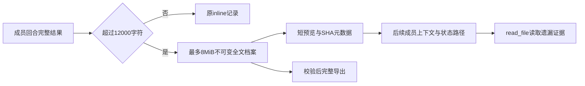

# Gemini Ultra CLI Swarm 完整成员结果交接

日期：2026-11-11。WI-091/E-215/F-059，候选preview.59。沿用R26/code-audit自有源码case、lead/cae/doc、scope授权granted。无付费模型、外部安全目标或个人配置/数据库/逆向工具改动。

## 发现与实现

旧Swarm成员回合保存时把result.text截为前12000字符，随后model
fullText镜像和/swarm
reports导出都仅有这段，缺失结果后部。4项旧core回归均失败；已安装58实际原生loopback协作链的verifier检查全文时收到截断文本，模拟端点主动拒绝400，不能完成任务。原日志保留；不是付费供应商故障，不因失败调用真实模型。

成员当前结果超过12000字符时，先保存到swarms/ID/results/full-SHA256.md，记录保存预览和fullResult的SHA/字节/字符元数据；单结果上限8MiB，越界明确标记该回合paused/failed，不把截断当作成功。成功与未完成成员结果都走此保存路径。短结果保留原inline兼容，后续短回合清除当前长结果指针，旧不可变档案仍保留。

上下文只注入1200字符左右的预览和实际全文路径，后续成员可以read_file读取；模型快照和导出读取时验证常规文件/长度/哈希，缺失或改动明确拒绝，预览不能替代全文。已完成前也验证当前成员档案，避免坏证据仍完成。成员异常时清除旧验证标记和不适用的旧全文指针。CLI
status显示当前语言的完整成员结果路径，UI仍显示短预览，reports导出当前成员全文及对应SHA；不会重新调度成员、审批或增加用量。

公开board仍是有长度上限的留言，长结果结束留言使用保存的带尾部预览；完整内容由结果档案提供，原board文件和已存消息不改写。之前版本已丢弃的文本无法恢复，legacy读取只能返回当时保存的内容。多次回合旧档案保留，reports沿用当前成员结果导出语义，不声称已增加全回合历史目录或崩溃事务回滚。

Evidence → Finding → Path：旧4回归和安装58截断全文 →
F-059持久化截断导致后续审查/导出丢证据 → 全文先归档、SHA引用与只读验证 → 定向失败/损坏/legacy检查及原生verifier跨12000字符读取、完整导出和文件哈希保持。

## 验证与限制

14项不同定向检查通过：成功/未完成全文交接和导出2、篡改与原文保持1、超限不接受1、缺失/硬链接内容变动2、后续短回合清指针且旧档案保留1、重复档案重用及legacy
inline1、等字节长度篡改校验SHA及拒绝覆盖1、已有context3、已有取消Swarm导出1、已有当前独立verdict但全文在完成前被改动时拒绝完成且状态保持1。硬链接项验证内容变化仍拒绝，不把它当成已测试符号链接权限；实际读取代码另拒绝符号链接叶文件。没有全量/冒烟，相关严格type/lint通过。

最终源码原生21个loopback请求、自然退出0，三具名成员/四唤醒，实际写入交付物、verifier读取长档案中的12000后证据再返回当前verdict；完整成员结果41490字符/字节，SHA7863e07c92a77ece7b1bff813830178f91fa942e1f0db009f3f7d7a7123cf32c，members状态3113字节。/swarm
status ID显示档案路径，/swarm reports
ID导出原全文和一致SHA，两本地命令不增加21请求，members/owner/board逐文件SHA保持。初源码业务链完成后status路径断言失败，发现CLI未显示已保存路径，补显示后最终通过；原失败保留。源码报告取上游nightly根版本，不是最终包版本。

三平台包/安装结果待追加，47至58未受影响基线保留。工程C:\Users\Administrator\Documents\ChatGPT\gmncliu：swarm-full-results-before*、swarm-full-results-junit.xml、swarm-full-results-boundaries*、swarm-full-results-digest*、swarm-full-results-legacy-export*、swarm-full-results-types.log、swarm-full-results-final-types.log、swarm-full-results-final-lint.log、swarm-full-results-installed58-before*、swarm-full-results-source*。

goal
active。58真实Teamwork有界交付基线保留，本轮是loopback原生全文保存/读取验证，不冒充新真实模型长任务。更多模型/长任务、旧报告丢失文本、全回合历史索引、恢复取消交错、长会话语义准确性和跨机复杂逆向继续。不合并master或创建正式Release。
