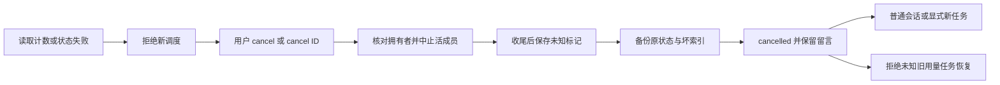

# Gemini Ultra CLI Swarm 状态恢复交接

日期：2026-11-11。本机双命令已安装 preview.36，产品源提交
`5c3ac52db14af282852ee4e5fb04cd3859be6554`。

## E-140 / F-038

E-139 的隔离复现证明：Swarm 预留两次调度后，删除 requests 字段会被 Schema 默认成零；非法字段又使取消失败。沿用 R26/code-audit、lead/cae/doc 与既有本地授权 scope，本阶段修复读取和显式取消，不调用真实供应商。

现在 budget 一旦存在，就必须包含六个合法限额/计数字段；缺失、非法、错误 UUID、超大状态均拒绝读取和调度。新记录保存 budgetVersion 和独立 owner.json；跟踪过的整个预算消失时也不能当作旧格式重置。真正旧格式没有预算时，仍保留从成员历史恢复可观察轮数的迁移；无法还原的旧请求量不宣称已知。

显式 `/swarm cancel` 在索引健康时取消最近蜂群；索引缺失或损坏时用
`/swarm cancel <ID>`，不枚举猜测任务。取消入口在读取最近蜂群前处理。坏 members.json 重命名为唯一备份，留言板原样保留，替代记录标为 cancelled/accountingUnknown；先持久化未知标记，再移动文件，防止中断后重新获得额度。坏 latest.json 同样备份修复。只坏索引且成员状态完整时，已知用量继续保留，取消后仍可显式恢复。

未知用量的旧蜂群不能 resume 或调大预算，状态摘要计数为 null，看板显示未知；需要用户显式创建新任务。删除替代 members.json 也不能移除独立未知标记。取消不等于完成，没有接受当前交付或伪造旧成员结果。

独立 owner.json 与索引拥有进程信息用于阻止取消另一个活 CLI 的任务。旧版本 JSON 完整、仅预算非法时，可从经过校验的 ownerPid 恢复拥有者。若旧版整个 JSON 和索引都坏掉且无独立拥有者信息，无法核实拥有者时仍拒绝，提示恢复 owner.json/绑定，不猜 PID。文件权限等 I/O 错误继续上报，不吞成格式错误。

本进程有成员运行时先请求中止，等待其收尾后再允许再次 cancel 恢复；第一次不会移动原状态，防止迟到成员覆盖替代记录。取消返回明确的本地提示，不新增模型调用。

## 必要证据

- 21 个相关 core 用例通过：Swarm 状态恢复 11、既有 Swarm
  7、工作流错误交接 3。覆盖七种成员/预算损坏、索引恢复且保留已知计数、活拥有者拒绝、旧格式拥有者迁移/无法核实时拒绝、原生成员先收尾再保留状态。3 个 CLI 用例通过：本地预算、指定 ID 取消、看板渲染/刷新/Esc。只检查相关功能，没有全量/冒烟。
- 受影响严格 lint、core/CLI 类型构建、格式和 diff 通过。辅助预算 fixture 改为显式提供全部计数，避免测试自己依赖被修掉的默认补零。
- 源码 bundle 实际 CLI：初始坏状态退出 1；`/swarm cancel ID`
  退出 0、0 请求；`/swarm resume`
  退出 42、0 请求；普通会话退出 0、1 个 loopback 请求。全场景 7227ms、2 个 loopback 请求，另一个请求仅创建隔离坏状态。原成员/索引备份逐字节匹配、原板未变、未知蜂群 cancelled、无工件。辅助脚本通过表示恢复门槛正确，不能称为真实交付成功。

Evidence→Finding→Path：E-139 缺计数补零/非法计数阻断取消 → F-038 →
E-140 严格读取、独立拥有者/未知标记、本地指定 ID 保留取消和恢复门槛。

工程目录：swarm-recovery-core.log、swarm-recovery-final.log 及 junit；swarm-recovery-cli.log/junit；swarm-recovery-types.log、swarm-recovery-lint.log、swarm-recovery-lint-final.log、swarm-recovery-lint-test-final.log；swarm-recovery-source-result.json 和对应输出。源码 bundle 不替代三平台最终包与本机安装身份。

## 接续边界

WI-066
Swarm 计数和状态/绑定恢复本地完成，preview.36 待分发安装。WI-067 后续处理 workflow 记录本体损坏的本地可取消路径，保持未知用量不自动清零。整个板文件损坏的读取/浏览、所有拥有者信息同时丢失、权限错误不在本轮扩大验收。WI-054 真实供应商完整自主交付/引用可靠性、WI-056 复杂逆向、隔离工作树及成员独立模型继续；goal
active，不合并 master、不发布正式 Release。

## E-141 三平台最终工件

[运行42897457849](https://github.com/emstudio010-hub/gemini-ultra-cli/actions/runs/42897457849)
completed/success，产品源5c3ac52db14af282852ee4e5fb04cd3859be6554。三个包的SHA/版本/源运行、安装记录和六rg二进制hash/Unix权限逐一核对。Swarm正常20请求/预算3请求/新增恢复2请求，以及工作流正常12请求/预算3请求/恢复2请求均通过，模型只用loopback
fixture。

| 平台        | 包SHA-256                                                        | Swarm恢复时长 | cancel/resume/普通会话 |
| ----------- | ---------------------------------------------------------------- | ------------- | ---------------------- |
| Windows x64 | f382ddbeb1f389acda7a313e6f7e0412e448fe621ce49244c2008334fb281ee8 | 9207ms        | 0 / 42 / 0             |
| Linux x64   | b3f82c1f158fa27f4e346bde21d609b431b72c38922a5a35343ee2d4db7c7efc | 3068ms        | 0 / 42 / 0             |
| macOS arm64 | 4f8429cd819d76a999a2c3f88eccf6bdbc0eee68f44bc522cce310e2f5aa6ec7 | 4017ms        | 0 / 42 / 0             |

每平台实际CLI新增恢复链：初始坏状态退出1；指定ID取消/拒绝旧任务恢复无模型请求，普通会话恢复后发1请求，加最初隔离坏状态seed合计2请求。成员和索引备份字节匹配，板未改，未知旧用量与cancelled保留，无工件和伪造完成。隔离时长不作跨平台性能基准，不替代真实供应商自主交付。

## E-142 本机安装

仅一次offline已有缓存安装6932ms/退出0；gemini-ultra和gemini-ultra-cli均1.0.0-preview.36，424包内文件与Windows
CI包逐一匹配。入口SHA为6e89987b8289cddf3352797faac23c82365b8deb218a02fe39aa90a3135af6f4。preview.35原包保留，不重复相同Windows
CI包已运行的fixture，不改个人供应商配置、数据库或逆向工具。

工程证据：github-preview36-run.json、github-preview36-artifacts-result.json、github-run-42897457849/各平台/swarm-recovery-verification.json和对应输出；global-preview36-install-result.json、global-install-github-preview36-full-result.json。WI-066交付，goal继续active，仅codex分支，不合并master、不发布正式Release。

## E-143 / F-039 下一阶段已复现

reproduce-workflow-record-corruption.mjs生成隔离工作流后只破坏原ID.json记录本体，完整预算/拥有者账本保留。取消失败；无关teamwork查询也失败，因为latestAgentWorkflow在过滤模式前先解析所有记录。原坏字节保留、0模型请求，workflow-record-corruption-before.json记录reproduced=true。

WI-067接续指定ID保留取消及坏历史记录不阻断其他模式的查询；没有真实用户数据损坏结论。WI-054真实完整自主交付/引用可靠性、WI-056复杂逆向、隔离工作树和成员独立模型仍待做，不因fixture通过关闭总目标。
