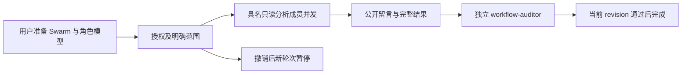

# Gemini Ultra CLI 原生红队 Swarm 交接

日期：2026-11-12。WI-104/E-253/F-071。R26/code-audit，自有源码接线审查，沿用 work/gemini-ultra-agent-20261110/scope.md，授权 granted，lead/cae/doc 在本会话承担。持续 goal
active。

## 功能缺口与接入

已有 redteam-analyst 本地角色，但 Swarm 的成员 schema、工具参数和独立选模只允许 researcher/coder/workflow-auditor，不能从蜂群调度该角色。4 项新回归在原源码实际失败，原日志保留。新增独立 Swarm 角色及模型 schema、SwarmAgentRunner 类型，保持 Boost/Teamwork 固定工作流角色定义；manage_swarm、保存/恢复、具名模型、CLI 提示同步接受 redteam-analyst。

红队成员沿用已有本地角色：可读源码/样本、调用只读二进制分析工具、记录事实、在当前蜂群身份下发公开留言；没有 shell、replace/write_file 或递归调度工具。分析文件只读，不是禁止事实归档的纯函数。红队成员与 researcher 同样可并发；写入者和独立审查仍串行，每轮及结果归档更新 revision，旧复核不能据此完成新任务。

添加成员前、排队轮次调用 runner 前检查演练授权。缺授权的 add 不修改成员、预算或留言；撤销后新轮次暂停并公开错误，恢复授权后明确提及可继续。累计失败/唤醒预算保持，授权失败也受已有失败上限约束，不无限重试。已经发出的请求不自动撤回；这项检查不代替明确任务范围或工具本身的权限约束。旧版本不识别新角色的任务状态，应使用此版本继续。

## 定向证据

Evidence → Finding → Path：4 项旧源码失败 →
F-071 已有红队角色无法加入蜂群 → 成员/参数/选模/runner 接线与授权检查 → 4 core +
1 CLI 定向通过。其他旧命令场景跳过；strict core/CLI typecheck、相关 lint 与 core
build通过。

verify-ultra-swarm-redteam.mjs 使用真实 Config.initialize、工具注册表、AgentRegistry、SwarmEngine 和归档代码；独立临时 profile，关闭技能发现和 hooks，拦截 fetch 确认 0 网络。核对工具 schema、本地角色工具范围、角色独立模型、两成员并发与 public
identity、超过 12000 字符的完整结果、授权添加拒绝、撤销暂停、恢复授权后继续和当前独立 verdict 完成。4 次成员 runner 使用受控响应，不是新的真实模型质量验收；每次均明确 modelRequests=0。首观察器误提前使用尚未初始化 AgentRegistry，及误调用未导出的 readSwarmResultText 导致阻塞的失败日志保留；改真实 Config 初始化并独立读取归档文件，不改产品去迎合观察器。此前短结果在成员状态内存储，不生成 fullResult，新测试原断言误要求归档，已改检查实际保留文本，首次失败保留。

工程证据在 C:/Users/Administrator/Documents/ChatGPT/gmncliu：swarm-redteam-before-junit.xml/-before.log，swarm-redteam-junit.xml/-log/-first.log，swarm-redteam-command-junit.xml/-log，swarm-redteam-types-final.log，swarm-redteam-cli-types.log，swarm-redteam-final-lint.log，swarm-redteam-build.log，swarm-redteam-source.json/-log/-first.log/-second.log。原类型错误也保存在 swarm-redteam-types.log；拆出正确 Swarm
runner 类型后严格检查通过。

候选 preview.71 待三平台 swarm-redteam 范围分发与安装；其他旧链跳过。当前已安装70及既有真实 Boost/Swarm/Teamwork 任务证据保留。个人 locale/provider
SHA 与70末值一致；不改个人数据库或逆向工具。没有全量/冒烟、不合并 master、不创建正式 Release，不宣称全面上线。
