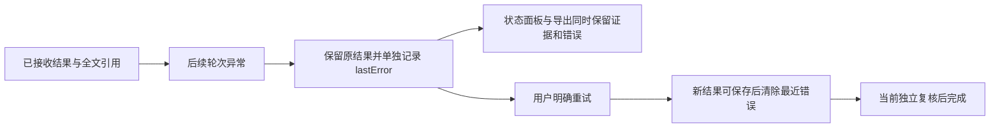

# Gemini Ultra CLI Swarm 失败后成果保留交接

日期：2026-11-12。WI-105/E-256/F-072。沿用 R26/code-audit 与 work/gemini-ultra-agent-20261110/scope.md，自有源码授权 granted，lead/cae/doc。持续 goal
active。

## 已确认问题与修复

成员已有结果后，后续轮次抛异常时，catch 原本将 member.result 改成错误并清空 fullResult；长报告文件虽未删除，其成员引用及常规导出入口丢失，短报告正文被覆盖。成员20次唤醒上限分支也覆盖结果预览。4个旧源码回归实际失败，原日志保留。

新增可选 lastError 独立保存最近异常，保留上一份结果、全文档案引用及对应模型记录；没有已有结果时仍保留首次错误在 result 的兼容行为。唤醒上限同样保留结果并公开暂停原因。只有新轮次接收到可保存结果才清除 lastError；新输出超过8MiB限制或异常不会替换旧成果。接受的新进度可替换旧结果，不提供无限版本历史；旧版本已丢失的短文本不宣称恢复。

模型快照及成员上下文分别传递结果和有界错误预览，CLI
status 与演练台详情独立显示最近错误。导出报告正文保持原结果；完整 snapshot.json 和 board.jsonl 包含错误。暂停仍阻止完成，明确重试后必须经过当前独立复核；累计失败预算不清零。红队成员的撤销暂停使用同一处理，相关验证脚本同步读取 lastError。

## 验证范围

Evidence → Finding → Path：4旧回归失败 →
F-072 后续失败覆盖已有成果 → 独立错误字段与保留结果路径 →
4core新场景、2中英文命令及1首次超限兼容场景通过。短/长报告后失败可读可导出、暂停不能完成、重试清错误且失败预算保持；新超限结果拒绝且旧全文不变；20次唤醒上限保留结果。其余旧场景跳过，没有全量或冒烟。strict
core/CLI types、相关lint和core build通过。

verify-ultra-swarm-result-recovery.mjs通过实际Config、AgentRegistry、SwarmEngine与报告导出代码，在独立临时profile拦截fetch、关闭技能发现/hooks。受控runner先交付长报告，再抛后续传输异常，核对原preview/归档/hash/模型记录、模型上下文全文、演练台详情错误、导出原文及错误快照，随后显式重试并独立复核完成。4成员runner/0模型/0网络；不代表新供应商请求或浏览器视觉验收。此改动只新增已有面板的文字字段，没有新动效或布局验收。

工程证据：swarm-result-recovery-before-junit.xml/-before.log、swarm-result-recovery-junit.xml/-log、swarm-result-recovery-command-junit.xml/-log、swarm-result-recovery-compat-junit.xml/-log、swarm-result-recovery-types.log、swarm-result-recovery-cli-types.log、swarm-result-recovery-lint.log、swarm-result-recovery-added-lint.log、swarm-result-recovery-build.log、swarm-result-recovery-source.json/-log，均在 C:/Users/Administrator/Documents/ChatGPT/gmncliu。一次脚本更新命令误以packages/core为根，产生空的同名脚本，已核对0字节并移入工程证据swarm-result-recovery-misplaced-empty-script.mjs，实际根目录脚本已修正；没有覆盖已有产品文件。

preview.72已通过三平台swarm-result-recovery范围分发并安装到本机；旧71红队与70精度等证据保持。个人供应商、语言、数据库及逆向工具不改。持续目标仍包括真实长任务和复杂跨机逆向，不能称全面上线，不合并master或正式Release。

## 三平台交付结果

E-257：产品源ba1d006f0be2a1e2a3dbcec78711caae8e643bd4/run43119144704三平台swarm-result-recovery范围completed/success；minimum-node、native-address-recheck及旧无关链skipped。独立核对三包版本72、源chunk、包/入口SHA、六rg身份权限及安装4基础工具。实际包Config/Swarm/模型与面板详情快照/报告导出通过受控后续异常链：原结果preview、全文档案SHA和模型记录保持，最近错误单独可见，模型全文交接及导出原文未变；暂停不能完成，明确重试后清错，累计失败预算保持，当前独立verdict后完成。4成员runner/0模型/网络，不冒充新供应商或浏览器视觉验收；71红队、70精度及旧未变更证据保持。

E-258：offline已有缓存安装6573ms/退出0，双命令preview.72，425文件匹配Windows
CI包。包SHA256
af1dbee7aa8c89bf431c96886f7fe3537e9f93d076730a9a147912a1d09e3b8c，入口SHA256
f47ca6d94c909265d2113bc2f46c0cbc30d497369f68ad4c0d9ecf406c5e01b9。旧归档保留，个人locale/provider哈希保持71末值，ultra-tools.json仍未创建。WI-105/F-072后续失败不覆盖已有成果分发交付；旧版本已丢失短报告不宣称恢复，更多真实长任务/复杂逆向继续。没有全量/冒烟/付费或未变更业务重跑，持续goal
active，不合并master或正式Release。

最终证据：github-preview72-run.json、github-preview72-artifacts-result.json、github-preview72-artifacts-verification.log、github-run-43119144704/、global-preview72-install-result.json、global-install-github-preview72-full-result.json、swarm-result-recovery-personal-config.json。源码、工程正式报告和Obsidian全文同步。

接续可返回启动/加载路径：已只读查看SkillManager.discoverSkills和loadSkillsFromDir，前者目录并发3、后者文件并发8且仅扫描两级；loadSkillFromFile仍整文件读取。尚未确认新的缺陷或修改技能加载模块，不应把该线索称为已复现卡顿。
