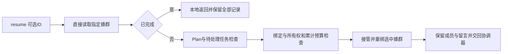

# Gemini Ultra CLI Swarm 历史恢复交接

日期：2026-11-11。WI-087，候选 preview.55。沿用 R26/code-audit 自有源码 case、lead/cae/doc，授权和范围见 work/gemini-ultra-agent-20261110/scope.md。没有新付费任务、外部安全目标、供应商配置/数据库/本机逆向工具改动。

## 离线复盘

E-202：按 call
ID 去重 E-198 原始会话，42次唯一工具调用、33次读取、2次错误。start_line/end_line 是有效的 read_file 参数，不能当作参数适配缺陷。两条错误是预算正常停止，以及审查成员尝试读取隔离工作树外的原仓库路径而被拒绝。不同阶段重新读取实际文件是独立审查的一部分，不能简单缓存或删除。

coder 曾用 write_file 写入11字符 placeholder，随后用19333字符恢复完整文件，因此多了重新核对源文件的开销。原真实任务脚本只开放 write_file，没有开放产品已有的 replace；不能据此声称产品没有局部编辑能力。未来代码任务应开放 replace，保持路径/权限/预算约束；本轮不修改已归档运行脚本、不重跑任务、不增加预算。复盘证据 audit-teamwork53-reads.mjs 和 teamwork53-read-audit.json；不能据此承诺真实成本或速度提升。

## 发现与修复

E-203/F-055：/swarm
resume 原先忽略输入ID。core 即便被直接传入历史ID，也不切换 latest 绑定；后续协调工具和模型请求计数仍可能落到较新蜂群。恢复还没有拒绝另一 active/blocked 蜂群或未关闭工作流，且在检查耗尽预算前接管旧owner并写盘。

现在 /swarm resume [任务ID]
直接读取指定蜂群；坏ID/缺失记录不回退。已完成蜂群在任何预算/绑定/权限更改前用当前语言本地返回，包含ID，留言与成员结果保留，即使无关latest绑定损坏也可查看此终态。无ID仍选择当前蜂群。补全保留ID输入空间，中文别名沿用。

非终态恢复拒绝 Plan
Mode；core 拒绝其他待处理工作流、另一active/blocked或尚有成员运行的蜂群、损坏绑定、活owner及耗尽预算。所有拒绝检查先于接管和状态修改，未知用量仍拒绝。通过后保留累计请求/失败/唤醒数、角色模型、留言和成员结果；接管已退出owner时将遗留working/queued成员暂停，killed成员不复活；追加恢复留言并把协调绑定切到选中的ID。成员仍需明确提及才继续，恢复本身不自动重试原付费工作。

Evidence → Finding →
Path：旧core定向6项中5失败/1通过，以及已安装54实际显式completed ID输出不含选中ID
→ F-055选择/绑定/待处理冲突和失败前写盘 →
CLI直接ID和core拒绝检查/重绑 → 定向检查及原生隔离命令的文件哈希/请求计数。

## 验证与限制

core13项通过；命令11项首轮9通过/2失败，CLI包入口使用旧dist，core重编译后仅复核两失败项通过，共24项不同检查。相关严格type/lint通过。旧core5失败和已安装54的错误输出保留，没有把夹具问题冒充新产品缺陷。

首轮新语言夹具遗漏临时 GEMINI_ULTRA_LOCALE_FILE，把本机 ultra-locale.json 写成en；未有事前原语言/字节快照，不声称已还原。之后每项使用临时文件，退出还原环境变量，后续原生命令也使用独立profile。本机当前界面偏好为英文，可用 /language 中文切换；没有自动修改供应商配置。

源码原生最终链16命令，只有正确选中的历史蜂群1次loopback协调请求，预算7→8，成员/模型/原留言保持，恢复追加一条留言，绑定选中旧ID；各拒绝与终态路径文件哈希断言均先完成。随后最终报告读取源码packages/cli/package.json的BOM导致JSON.parse失败，实际进程退出1，不能记作整条脚本成功；其内存中的逐场景before/after映射未输出。离线核对16命令原输出、accepted请求和metadata异常位置，并单独验证去BOM解析后版本可读。保留原失败，不重复本机业务链；三平台包的最终脚本须完整退出0并保存映射。更早源码链的坏绑定错误期望专用binding文案，但JSON解析实际返回通用state
damaged，已只修夹具预期，不改产品保护。

工程证据位于 C:\Users\Administrator\Documents\ChatGPT\gmncliu：swarm-resume-before*、swarm-resume-core*、swarm-resume-command*、swarm-resume-lint.log、swarm-resume-cli-types.log、swarm-resume-script-lint.log、swarm-resume-installed54-before*、swarm-resume-source\*、review-swarm-resume-source.mjs。源码报告版本来自上游根包。55三平台包/安装结果待追加。

goal active。真实Teamwork
E-198仍预算blocked，未变为成功；Swarm已有真实有界交付基线保留，本轮种入历史状态和loopback协调不算新真实多成员交付。更多模型、长任务、长会话语义准确性及复杂跨机逆向继续，不合并master或创建正式Release。
