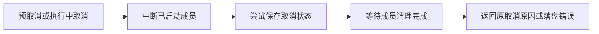

# Gemini Ultra CLI Swarm 等待取消收尾交接

日期：2026-11-12。WI-127 / E-309至310 /
F-087。持续目标active。本轮在用户暂停后恢复，复用暂停前已经完成的检查和编译结果；没有重启旧进程或重跑付费任务。保持源码优先、Windows定向验证、功能收敛后统一打包。全局安装仍preview.83，源码修复尚未打包或全局安装。

## 修复内容

F-087：SwarmEngine.wait原先只注册abort监听，然后立即throwIfAborted。若信号在调用前已取消，监听不会触发，排队/运行成员可能继续执行。公开manage_swarm
wait另有提前throwIfAborted，也会绕过引擎清理。执行中取消时，监听直接调用cancel；状态落盘异常会从abort事件回调逃逸，且cancel先保存状态再stopMembers，保存失败可能导致成员没有被中断。

现在wait先注册监听，再主动处理预取消；取消时先中断成员，再尝试保存取消状态。落盘异常保存在等待请求中，避免从事件回调抛出。wait等已启动成员全部结束后返回：落盘成功返回原取消原因，落盘失败报告保存错误。公开工具仅对wait保留进入清理的机会，其他操作的预取消拒绝保持，Plan模式限制保持。没有新增模型调用或自动恢复。

## 必要验证

E-309：旧实现3个引擎预取消/保存失败复现全部失败；引擎修复后补查公开工具，旧公开入口1项实际失败。最终5项相关检查通过：公开工具预取消、排队成员预取消、运行成员预取消、预取消保存失败、执行中取消保存失败。另已有正常留言唤醒和共享失败预算中断2个直接相关对照通过。没有全量/冒烟；最终strict
core类型检查及源码编译、3个修改文件eslint均退出0。暂停前进程63961/51560/66586在恢复后读取终态均退出0，没有重复执行。

命令在packages/core执行：`npx vitest run src/agents/swarmWaitCancellation.test.ts --coverage.enabled=false`；对照限定`src/agents/swarm.test.ts --testNamePattern='aborts a concurrently running peer|posts publicly under native member identity'`。根目录`npx tsc -p packages/core/tsconfig.json`编译源码，没有调用package构建脚本。

E-310：Windows Node
v24.19.0实际编译源码ManageSwarmTool/SwarmEngine，最小上下文适配器、两个真实协作退出的Node子进程及一个实际只读members.json文件，21618ms/退出0。公开工具预取消零runner调用、状态cancelled、无运行成员。运行成员预取消及等待期间实际EPERM保存失败两条路径，子进程均收到取消，清理未释放前wait保持等待，释放后自然退出0且running清空；成员paused，累计唤醒1/失败0保持，无未捕获异常。保存失败时在解除只读前原members.json字节保持；owner.json可能已写入，不宣称跨文件原子事务。最终脚本清理为自己的隔离目录，未执行用户原生逆向工具或模型。

证据根：C:/Users/Administrator/Documents/ChatGPT/gmncliu。文件包括swarm-wait-cancel-before.log/-junit.xml、swarm-wait-tool-before.log/-junit.xml、swarm-wait-cancel-final.log/-junit.xml、swarm-wait-cancel-controls.log/-junit.xml、swarm-wait-cancel-final-source-compile.log、swarm-wait-cancel-final-lint.log、verify-source-swarm-wait-cancel.mjs、source-swarm-wait-cancel-result.json、source-swarm-wait-cancel.log。辅助脚本不随包分发。

## 边界与接续

沿用work/gemini-ultra-agent-20261110/scope.md的R26自有源码范围，lead/cae/doc由本会话承担。不新增外部目标、付费调用、旧任务重跑或个人数据库修改。locale/provider
SHA保持4fcce506592e55074156cab2f5fea35cce0d48ea5f8c919b69cd71ffc735f2c8 /
e0bff750cd1f18458cffc175ad3683d1851bbc58958fb4182dd15d9e128e4332，个人ultra-tools.json仍不存在。

验证覆盖协作响应取消的成员；没有强杀不响应信号的运行器或承诺固定取消时长。取消状态保存失败时，已启动成员被中断并收尾，但磁盘phase可能仍为active，需要解除文件故障后显式cancel；本轮没有伪造保存成功或自动重试。这里不是完整终端UI、真实供应商取消或最终跨平台验收。继续源码功能收敛，最终统一Windows交付及macOS/Linux分发，持续目标不标完成。隔离codex分支同步带skip
ci，不合并master或正式Release。
