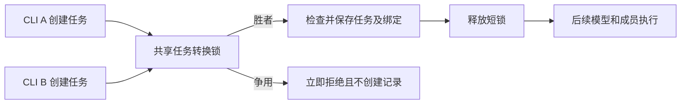

# Gemini Ultra CLI 跨进程任务创建交接

日期：2026-11-11。WI-089/E-209/F-057，候选preview.57。沿用R26/code-audit自有源码case、lead/cae/doc，scope授权granted；不重新初始化历史case。没有付费模型、外部安全目标或个人配置/数据库/逆向工具改动。

## 发现与实现

56修复了已保存状态的跨模式冲突，创建时检查和发布绑定仍是两个分开的步骤。已安装56实际两个独立CLI创建Swarm，在各自写入latest绑定前暂停，再同时放行：两者均退出0，形成两个active记录但仅一份latest绑定，0模型请求。原错误记录、两个发布屏障和输出保留；不是只用同进程Promise模拟并发。

共享短时锁覆盖“检查现有任务→创建/激活记录及预算→发布绑定”，创建Swarm/工作流、预算激活和Swarm恢复、直接工作流运行的启动转换共用。项目临时目录先解析真实路径，Windows在同进程重入键中忽略大小写，等价路径同步嵌套可重入。锁争用立即显示Another
CLI is updating Agent task
state，命令退出42，调用者可稍后明确重试。没有自动增加模型预算或反复派发。

锁只包围同步状态转换；等待成员收尾、模型/工具执行不持有此锁，既有写入成员/独立审查的执行锁与串行队列保持。运行入口获得短锁后再次检查Swarm状态，争用发生在标记running之前，避免仅因抢锁失败把原ready任务改成blocked。完成Swarm的本地返回保持只读，不因别的转换抢锁。

使用已有proper-lockfile，重试0，stale阈值30秒，正常/异常返回均释放。过期目录夹具验证可恢复，不代表已实测硬崩溃、时钟异常或网络文件系统。不同版本CLI没有共享此新锁时不具备相同保证。新建前后多文件写入不是崩溃原子事务，本轮不声称任意中断都能回滚。

Evidence → Finding → Path：安装56两个CLI均成功/两个active记录/单绑定 →
F-057检查与发布无互斥 → 共享短锁及同步重入 → 源码三组独立CLI竞争仅一胜者、无落败方半份记录/残留锁/模型请求。

## 验证与边界

源码原生三组：Swarm/Swarm、Teamwork/Boost、Swarm/Teamwork。9次CLI进程（3初始化、6竞争），每组一退出0/一预期42，仅胜者到达发布屏障、仅一份任务记录和绑定，预算requests0、0模型、无残留转换锁。屏障仅在真实绑定文件发布前暂停，不替换检查结果或写入数据；上限20秒低于生产锁30秒stale，减少夹具自身造成过期的干扰。源码运行时使用45秒屏障且已通过，后只缩短夹具期限，最终包须用20秒版本完成相同三组。

6项相关core定向检查通过：等价路径嵌套失败后释放、过期锁目录夹具恢复、完整工作流审查修正与最终审查、Swarm累计预算取消/恢复、直接运行拒绝冲突、已取消成员收尾期间拒绝激活/创建工作流或Swarm并在收尾后允许；新增Swarm断言后仅复核该项。未跑全量或冒烟。相关严格type/lint通过；三平台包/安装结果待追加。

工程C:\Users\Administrator\Documents\ChatGPT\gmncliu：task-claims-installed56-before*、task-claims-source*、task-claims-core\*、task-claims-types.log、task-claims-lint.log。源码报告版本取上游nightly根包；不是最终preview版本。本机locale
SHA保持56阶段末值。

goal active。真实Teamwork
E-198预算blocked保留；这次是任务状态并发验证，不是新真实多成员交付。并发恢复/取消的更多交错、旧新版本混用、更多模型/长任务、长会话语义准确性及复杂跨机逆向继续。不合并master或创建正式Release。
