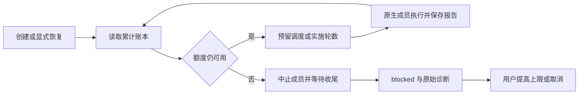

# Gemini Ultra CLI 工作流累计预算交接

日期：2026-11-11。本机双命令已安装 preview.34，产品源提交
`5f37e00a2de5f303b03e3909b44200bf56d95af1`。

## E-131 / F-035

原 `runAgentWorkflow` 每次从 `round = 1`
开始，恢复同一里程碑会重获两轮实施机会。旧报告虽保留，但未用于预算。Teamwork/Boost 也没有任务级模型调度计数。沿用 R26/code-audit、lead/cae/doc 和已授权 scope，只检查本地 TypeScript、CLI 和 loopback
fixture，没有新付费模型任务。

现增加独立的 `<ID>.budget.json`
账本，默认 240 次模型调度、4 个失败阶段、每里程碑累计 2 次实施。计数包括已经预留但被取消的尝试；“实施两轮”包含首轮，不能读成额外两次修正。调度次数是应用交给生成器的次数，不是 Token、费用或 SDK 内部 HTTP 重试总数。

主会话、访谈、子成员及辅助生成经共享模型入口预留调度。阶段报告和预算分开保存，防止并行调查的旧报告对象覆盖最新用量。阶段失败及未通过的结构化审查累计失败额度；预算中止导致的同伴取消不重复记失败。实施轮次在启动前持久化，恢复从已花轮数继续。旧报告迁移已观察到的实施次数/中断阶段和失败审查；历史模型调度无法还原，从迁移后计数，不能宣称补齐历史用量。

触限会中止所有已发起成员，等待它们收尾后释放工作区，保留 `blocked`、报告和预算
`paused`。根因写进阶段和每份预算中止报告，底层原始取消诊断另保留，不把预算停止归因用户。没有写入成员、当前审查或工件时，不标完成。完成/取消关闭额度绑定，普通主会话可继续；恢复旧任务仍保留原累计值并核对剩余额度。其他活进程拥有的任务在任何状态修改前被拒绝。

本地命令：`/boost budget 240 4 2`，或
`/teamwork budget 240 4 2`；第三个数是每里程碑累计实施轮数上限。`status`
显示账本；提高已耗尽上限后显式
`resume`。数字严格校验，只修改限额、不发模型请求、不重置计数、不作为模型工具。Grill
me 访谈同样累计调度，`finish`
关闭访谈账本并继续已约定任务；访谈完成后的新任务不再计入旧访谈。

同工作区有未解决的原生工作流或 Swarm 时，先恢复或取消，避免两种预算错误叠加、悄悄替换任务绑定。现有 Teamwork 草案显式批准、Plan 只读、串行写入及独立最终审查保持。

## 必要验证

- 28 个相关 core 用例覆盖最终工作流 11 项、错误交接 3 项、Swarm
  7 项及供应商预算 7 项；4 个 CLI 命令用例通过。包含恢复不重获实施轮数、提高上限保留计数、并行记录不覆盖调度、耗尽中止同伴、失败阶段上限、旧记录迁移、跨模式互斥、其他活拥有者不被修改，以及本地预算命令不提交模型请求。
- 受影响严格 lint、core/CLI 类型构建、格式和 diff 检查通过。初次 helper 尚未接线时 lint 报 budgetMode 未使用，完成预算场景后修正，原日志保留。没有全量/冒烟。
- 源码 bundle 正常原生五阶段：12 个 loopback 请求 / 2064ms /
  CLI 退出 0；实际写入并独立读取工件，账本累计 10 次成员调度、1 次实施、0 失败，完成后 closed。首个请求创建隔离状态、最后主会话在任务完成后总结，均不计入该 fixture 的成员账本。
- 源码 bundle 预算停止：3 个 loopback 请求 / 1825ms /
  CLI 自行退出 1；初次请求创建隔离状态，之后最多 2 次累计调度。两条调查部分报告保留并标注预算根因，写入成员未启动，无工件，工作流 blocked、账本 paused，没有观察者终止。辅助脚本退出 0 表示失败门槛符合预期，不是任务交付。

Evidence→Finding→Path：原恢复循环重新从第一轮开始与任务级计数缺失 → F-035 →
E-131 独立累计账本、生成入口预留、原生轮数/失败上限和本地恢复门槛。

工程证据：`workflow-budget-core.log`、`workflow-budget-final.log`、`workflow-budget-ownership-final.log`、各自 junit；`workflow-budget-cli.log`、`workflow-budget-cli-junit.xml`；`workflow-budget-types.log`、`workflow-budget-lint.log`、`workflow-budget-lint-final.log`；`workflow-budget-source-delivery.json`、`workflow-budget-source-stop.json`
及输出。初版停止报告在
`workflow-budget-source-stop-initial.json`，原底层泛化取消文本保留；最终报告增加明确预算原因。源码 bundle 不替代最终三平台安装包身份。

## 接续

WI-064 累计预算本地实现完成，准备 preview.34 分发与安装。WI-065 继续处理预算状态损坏时的可取消恢复，确保未知旧用量不被静默清零；之后再选择有收益的真实工作验收，不重复同一付费报告。真实供应商无人介入交付/引用准确性、复杂逆向、隔离 Git
worktree 和成员独立模型仍未完成。保留 goal
active，不合并 master、不正式发布 Release。

## E-132 三平台包

[运行42891302374](https://github.com/emstudio010-hub/gemini-ultra-cli/actions/runs/42891302374)
completed/success，源5f37e00a2de5f303b03e3909b44200bf56d95af1。每平台工件版本/SHA、安装报告、六rg二进制hash/Unix权限核对通过；原生Swarm正常20请求/预算3请求，以及新工作流正常12请求/预算3请求均通过，响应仅loopback
fixture。

| 平台        | 包SHA-256                                                        | 正常五阶段     | 预算停止       |
| ----------- | ---------------------------------------------------------------- | -------------- | -------------- |
| Windows x64 | 911c84a5e18cf0b31d82e50c36ce0a4c208ee3e061b623e159c449ff6d4baf1a | 1487ms / 退出0 | 1311ms / 退出1 |
| Linux x64   | e7dfcfa5330337d092f2145bf26684d681fa836b0e77fe3381326094d1e541f1 | 1214ms / 退出0 | 1051ms / 退出1 |
| macOS arm64 | 18f4187a3443f7f0e71ef5e0d00b392234c3f438843ac3ea8f02b27433f58542 | 1063ms / 退出0 | 971ms / 退出1  |

正常场景独立最终审查通过，账本closed/10次成员调度/1次实施；停止场景blocked/paused/2次累计调度，未启动writer，原报告带预算原因。耗尽场景退出1为程序有界失败，辅助报告passed只表示这个门槛正确，不等于业务完成。隔离时长不作跨平台性能基准。

## E-133 本机安装

仅一次offline已有缓存安装：7038ms/退出0；两个命令均1.0.0-preview.34，424包内文件与Windows
CI包逐一匹配。入口SHA为9dce84e0e66c7338839bdfc785e822bea665af38233544c3159fe8ac8c7c61bd。旧preview.33包保留；不重复已由相同Windows包执行的fixture，不改个人供应商/数据库/逆向工具。

工程记录：github-preview34-run.json、github-preview34-artifacts-result.json、github-run-42891302374/各平台/workflow-verification.json与workflow-budget-verification.json及对应输出；global-preview34-install-result.json、global-install-github-preview34-full-result.json。WI-064原生累计预算交付完成；仍非真实供应商自主交付验收。

## E-134 / F-036 下一项已复现

reproduce-workflow-budget-corruption.mjs在全新生成的隔离项目上预留两次调度（未调用模型），随后将账本替换为坏JSON。现有cancel和后续调度均拒绝，工作流仍ready，坏文件字节保持原值。workflow-budget-corruption-before.json记录reproduced=true、0模型请求；临时夹随后清理。它是状态恢复缺陷，未观察到真实用户数据损坏，也没有静默清零用量。

WI-065接续：允许保留坏账本后显式取消；未知历史用量必须标记并阻止直接恢复为新预算，避免恢复操作绕过已花额度。此问题尚未修复，不能称整个系统已可正式上线。随后继续WI-054真实自主交付/引用可靠性、WI-056复杂逆向以及隔离工作树/成员独立模型。目标active，仅codex分支，未合并master、未发布正式Release。
