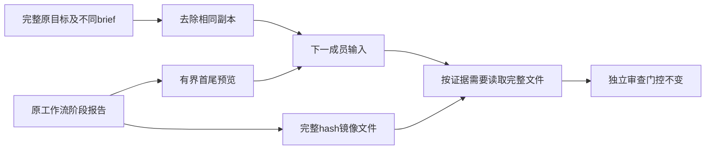

# Gemini Ultra CLI 工作流交接上下文精简

日期：2026-11-11。WI-072/E-157；本机双命令已安装preview.41，产品源7b1d271f3b6af77b78041e6673df4c375e01a04e。沿用R26/code-audit自有源码case与lead/cae/doc，依据上一轮真实Boost记录优化，不发起新的真实模型任务。

## 根因与修改

E-156的真实生成样本任务成功，但410835ms/23请求、422720报告Token不能称为高效。当前源码确认Boost默认objective、brief和里程碑标题重复，五份实际成员任务输入各出现三遍同一完整目标；阶段交接又直接内联最近4份报告，各最多6000字符。它只是整体请求成本的一部分，不能将全部耗时/Token归因于此。

新增workflowContext.ts：仅完全相同的objective/brief/默认标题改为指向上文的引用，不丢失不同brief或自定义里程碑的约束。默认超过2000字的标题前缀明确表示为目标的前2000字符引用；最终审查仍收到全部里程碑和原始目标，不跳过阶段或整体独立审查。

近期阶段正文不超过1200字符时完整内联；长正文给出前900+后300字符的明确截断预览，并提供完整报告文件、原字符数与SHA-256。完整正文同时保留在原工作流JSON和项目临时目录agent-workflows/ID.reports/下的hash命名Markdown镜像；旧任务恢复时可按原记录补生成，不需要改账本或重置计数。镜像用独占创建，不覆盖已存在文件；已有文件内容/hash变动或符号链接时拒绝使用并保留它，原工作流记录不修改。

提示成员在需要缺失信息、处理失败审查或做独立审查时读完整报告，不把预览省略当作证据不存在；复用未变工件，只为具体证据缺口或输入改变重复分析。调查前没有长报告时，省略多余长篇阅读说明。完整文件在项目temp内，沿用Config的既有允许读取范围，不新增文件权限。Swarm/模型路由/累计预算/工具超时/工作树回写门控不改。

## 必要核对

- 13项相关工作流用例通过，包括原先的批准、取消、故障/累计预算、阶段及整体审查门控；新增两项覆盖：超过6000字符的调查与失败审查中段信息仍由实际镜像文件读到并用于下一轮，整个目标在成员提示词中只出现一次；不同brief/里程碑保留，旧报告补镜像及外部改动不覆盖。未放宽判定以凑通过。
- 严格相关lint、core/CLI类型构建、格式及diff检查通过；没有全量/冒烟，没有真实模型请求。
- 源码bundle真实CLI执行链使用loopback响应，13请求/11任务调度，coder实际read_file读取被预览省略的中段，再write_file交付，阶段/最终审查照常。五个成员输入均只有一次完整目标，原长报告仍留在工作流记录；退出0。最终版本待同源CI包再次核对，不重复未受影响的本地场景。

## 对已有真实记录的离线比较

复用E-156保存的五个原生成员任务输入，重新格式化同一objective/brief/里程碑和原阶段报告，完整正文镜像逐字节核对：

| 范围                     | 修改前     | 修改后             | 变化                |
| ------------------------ | ---------- | ------------------ | ------------------- |
| 五份成员任务输入字符     | 36044      | 24685              | 减少11359，约31.51% |
| 每份输入里的完整目标副本 | 3          | 1                  | 原目标保持完整      |
| 所需完整长报告           | 原JSON保存 | JSON及可读镜像保存 | 正文逐字节一致      |

这不是重跑真实任务，不能声称总Token/账单/耗时下降31.51%；系统提示词、主会话、历史推理与工具返回均不在此字符比较范围内。成员仍可能按需要读取完整报告并增加一次请求。镜像额外占用少量项目temp空间；完整原记录继续是权威数据。

Evidence→Finding→Path：E-156真实交付成本较高 →
E-157保留的成员输入与源码均确认目标3份/长报告重复内联 →
WI-072精简交接、完整证据保留及CLI实际读取。原真实任务成功与两处措辞问题保持，不借离线比较改写质量或速度证据。

工程根C:\Users\Administrator\Documents\ChatGPT\gmncliu：workflow-context-replay-result.json/-log及-replay-artifacts、replay-workflow-context.mts；workflow-context-final-test.log/junit、workflow-context-final-lint.log、workflow-context-final-types.log、workflow-context-source.json及输出。离线比较源仍为preview40-live-boost-reverse-\*，没有新增付费任务。

## 接续

WI-072本地完成，preview.41待三平台最终包及安装身份核对。沿用已授权codex隔离分支，不合并master、不正式Release；每阶段同步Obsidian。WI-054真实Swarm、长任务、更多模型及摘要准确性仍未完成，复杂逆向边界保留；整体goal
active，不以一次成功或提示词精简宣称全面可上线。

## E-158 三平台最终包

[运行42919315474](https://github.com/emstudio010-hub/gemini-ultra-cli/actions/runs/42919315474)
completed/success，产品源7b1d271f3b6af77b78041e6673df4c375e01a04e。三个工件版本/SHA/来源提交、安装报告、六rg二进制hash及Unix权限核对通过。同源既有Swarm/工作流两入口多模型、预算/恢复、工作树及原生Ghidra链通过。

| 平台        | 包SHA-256                                                        | 新长交接链              |
| ----------- | ---------------------------------------------------------------- | ----------------------- |
| Windows x64 | 7d30cc4e4168e4a95b0e7323dc0a52c75e340de386edc775158afd36e094d182 | 1202ms / 13请求 / 退出0 |
| Linux x64   | a2eecc741454f8e999ce1ff6f5538be22e1110c6c8570ff73abec6e445e5b206 | 963ms / 13请求 / 退出0  |
| macOS arm64 | 9de08e121b5c3838858984eae268b7f337d2e80b1a32a6d998ce7d7c7805fd9a | 953ms / 13请求 / 退出0  |

每平台实际安装CLI和原生子执行器，五份成员输入目标各出现一次；coder通过read_file读到预览省略的中段证据后write_file交付，原长报告正文保留，阶段及整体审查完成。11次任务调度、一次实施预算保持，任务自然completed。响应为loopback
fixture；不作真实模型质量、成本或跨平台性能比较。

## E-159 本机安装

一次offline已有缓存安装7171ms/退出0；gemini-ultra和gemini-ultra-cli均1.0.0-preview.41，424包内文件逐一匹配Windows
CI包。入口SHA
c03fa5b2fa219f45bb5dcb196fcdcd4e6bb0891c4a97763eb364e6d6845db7de。旧preview.40包保留；不重复Windows同工件fixture、真实付费任务，不改个人供应商配置、数据库或逆向工具。

工程证据：github-preview41-run.json、github-preview41-artifacts-result.json、github-run-42919315474各平台workflow-context-verification.json及-output.txt；global-preview41-install-result.json、global-install-github-preview41-full-result.json。源码/工程/Obsidian交接同步。

WI-072交付，整体goal
active。仅证明减少无条件重复交接并保留可读证据，真实总Token/费用/耗时收益仍未度量，不为此自动重跑E-156。真实Swarm、长任务、更多模型及摘要准确性、复杂逆向仍有边界。不合并master、不正式Release。
