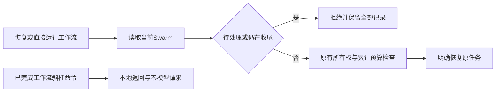

# Gemini Ultra CLI 工作流与 Swarm 冲突保护交接

日期：2026-11-11。WI-088/E-206/F-056，候选preview.56。沿用R26/code-audit自有源码case、lead/cae/doc，scope授权granted；不重建case覆盖历史。无付费模型重试、外部安全目标或个人配置/数据库/逆向工具改动。

## 发现与修复

55已修复Swarm恢复方向，反向activateWorkflowBudget仍仅检查其他工作流，不查Swarm。直接调用runAgentWorkflow也可绕过斜杠命令进入成员执行。旧core9项中7失败、2个终态允许场景通过；已安装55在Swarm
active时恢复旧Boost，实际发送1次不应发生的loopback模型请求并改写workflow记录、预算和current绑定三文件。模拟端点明确拒绝此请求，最终HTTP400；这不是付费供应商故障，也没有真实外部请求。原始before/after
SHA和输出保留。

现在共享只读assertNoPendingSwarm检查当前Swarm是否active、blocked或仍有本进程成员运行，损坏绑定也拒绝。预算激活在workflowBudget读取/旧账本初始化之前调用；直接工作流执行在创建运行目录、读写阶段和启动成员之前调用；创建工作流在首次落盘前调用，避免已取消成员尚未收尾时产生半份新任务。各入口保留原所有权、累计预算、权限与工作树规则。

Swarm正常cancelled/completed且成员收尾后，工作流可继续，累计用量保持；已完成工作流仍由斜杠命令本地返回，即使Swarm
active也不触发激活检查或模型调度。没有自动取消别的任务、清零预算或提升权限。不同CLI进程同时抢占空闲工作区的竞态，本轮未实测，不能将已有状态的冲突检查当成完整跨进程事务锁证明。

Evidence → Finding → Path：旧core失败和安装55实际错误调度/三文件改写 →
F-056反向激活与直接运行缺Swarm检查 → 共享只读门控置于初始化和落盘前 →
core状态快照/原生拒绝零请求及终态后合法恢复。

## 验证与边界

10项不同core检查通过：三个模式激活、blocked、旧账本不初始化、坏binding、两个终态允许、直接运行零成员、已取消成员收尾阻断并在收尾后允许。收尾项增加新建不落盘断言后只复核该项，未重跑前9项。相关严格type/lint通过，未运行全量或冒烟。

源码原生8命令，3退出0/5预期42，6个拒绝/终态场景的9份记录/账本/绑定/留言文件SHA逐一前后匹配；拒绝阶段0模型请求。Swarm取消后仅历史Teamwork草案1次loopback调度，仍scoping/approved=false，预算7→8/限制30/失败0/实施轮数[]，绑定旧Teamwork
ID；6个非选中文件SHA保持。源码报告版本来自上游nightly根包，不是最终preview版本。

三平台分发/安装结果待追加。工程证据目录C:\Users\Administrator\Documents\ChatGPT\gmncliu：workflow-exclusion-before*、workflow-exclusion-core*、workflow-exclusion-settling*、workflow-exclusion-final-settling*、workflow-exclusion-types.log、workflow-exclusion-final-types.log、workflow-exclusion-final-lint.log、workflow-exclusion-installed55-before\*、workflow-exclusion-source\*。本轮所有语言/供应商端点使用隔离profile，延续前阶段已披露的本机en偏好，不再次修改；本机locale
SHA与55阶段末一致。

goal active。真实Teamwork
E-198预算blocked保留；既有Swarm真实有界交付不变。本轮状态由宿主种入、模型由loopback提供，不冒充新真实多成员交付。更多模型、长任务、长会话语义准确性和跨机复杂逆向继续。不合并master或创建正式Release。
