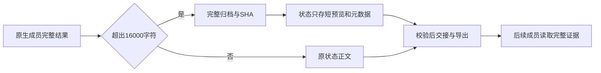

# Gemini Ultra CLI 长阶段报告完整保存交接

日期：2026-11-11。WI-081/E-182，候选preview.49。沿用R26/code-audit自有源码case、lead/cae/doc；scope
granted，case
guard退出0。现有case初始化已完成，不运行会覆盖历史scope和timeline的重新初始化。没有外部扫描、付费模型、个人配置/数据库/逆向工具改动。

## 发现与修复

F-049：runAgentWorkflow先把成员结果截为约16000字符再写JSON，workflowContext随后只给这个截断结果建“全文”镜像。模型实际返回但超出上限的中段/尾段无法由后续成员或reports导出恢复，和提示词中的全文保留语义矛盾。

新阶段正文超过16000字符时，先写项目临时目录中按SHA命名的完整UTF-8归档；状态保留首尾1245字符预览及sha256/bytes/chars。归档仅首次写入，已有内容先校验，不覆盖外部改动。交接读取并校验完整归档，再提供有界预览和完整路径；本地reports导出同样取完整原文并生成哈希。短报告和旧记录形状兼容，状态/预算/批准不因导出改变。

单份归档上限8MiB，超过上限或落盘失败明确标为失败并阻塞，不声称已完整保存。归档缺失、变更、符号链接或哈希/长度不符时，交接/导出明确拒绝，不静默退回预览。旧版本已经丢失的文本不能凭空恢复；现有100份阶段记录窗口与Swarm结果存储上限未扩展。

## 验证与证据链

旧实现2项长报告回归失败；修后3项新用例加13项原工作流和3项导出，共19项通过。覆盖原生阶段超过16000字符的Unicode正文、中段证据、完整导出及原记录字节保持；归档修改/缺失拒绝且不覆盖；超过8MiB时不启动写入成员并保留失败诊断。严格相关lint/type通过，不运行全量/冒烟。

源码实际CLI
loopback链13请求、11任务调度、五阶段completed、自然退出0：两名researcher真实complete_task返回36290字符正文，JSON各存1245字符预览；coder经原生read_file取归档，读到超过16000位置的标记后write_file交付，阶段及整体独立审查完成。本地reports不增加请求，两个导出正文/sha256/字节数匹配原36290字符，原任务与源seed保持。不是seed伪造的长报告，也不代表真实模型长任务质量验收。源码report.version取上游nightly元数据，最终分发另核对。

Evidence→Finding→Path：E-182原生阶段输出与截断调用链 →
F-049先截断再建立镜像导致不可恢复证据 → 完整不可变归档、短状态、校验交接与导出 → 原生read_file读中段、完整导出及异常拒绝。

工程C:\Users\Administrator\Documents\ChatGPT\gmncliu：workflow-full-report-before.log/-junit.xml、workflow-full-report-test.log/-junit.xml、workflow-full-report-lint.log/-types.log、workflow-full-report-source.json/-output.txt。红队角色注册、只读工具及事实归档入口保持；本阶段没有再次运行旧红队或逆向任务。

## 分发与剩余边界

候选49使用显式workflow-reports范围做三平台新鲜包/安装/本次长报告链。未受影响Swarm、Teamwork草案流程、供应商配置和Ghidra不重复；完整基线47/run43018021899，供应商及默认网关基线48/run43024019734。最终源、run、包SHA和全局安装待追加。

goal
active，只推送codex分支，不合并master/正式Release。真实Teamwork长任务、更多模型与更复杂逆向、长会话摘要准确性仍待验收；旧截断内容、100份报告窗口与Swarm存储上限不因本轮修复而宣称解决。
