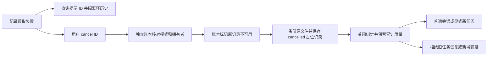

# Gemini Ultra CLI 工作流原记录恢复交接

日期：2026-11-11。本机双命令已安装 preview.37，产品源提交
`7d56d192195a3bb50cd16a0307653607ebf6f3a2`。

## E-144 / F-039

E-143 已离线复现：原工作流 ID.json 损坏时 cancel 失败，且 latestAgentWorkflow 在模式筛选之前解析全部历史记录，连无关模式查询也被阻断。此次沿用 R26/code-audit、lead/cae/doc 和现有本地授权，只修改 TypeScript 原生工作流、CLI 与 loopback 验证辅助脚本。

读取现在区分 JSON/Schema/ID/超大文件损坏与真实 I/O 错误；原 ID 必须匹配文件名。查询隔离坏历史记录，CLI 显示具体 ID 和本地 cancel 用法，不改原文件。若坏的是当前绑定中同模式的活任务，禁止静默回落到更早任务。其他模式仍可查询，任何恢复也不能覆盖另一个未解决任务的预算绑定。

新增本地
`/boost cancel <ID>`、`/teamwork cancel <ID>`、`/grill-me cancel <ID>`，在 latest 查询之前处理。取消从独立预算账本核对原模式/拥有者，运行锁或其他活拥有者存在时拒绝；本地运行中的成员先中止并收尾，之后才能恢复。原记录损坏但账本完整时，先在账本持久化 recordUnavailable/备份路径，再移动坏记录并保存取消占位记录。占位记录不声称还原了原需求、报告或审查结果，原始内容逐字节保留在备份中。

独立累计预算不重置：已知模型调度、失败阶段、实施轮数完整保留。原记录不可用时，即使额度足够，也禁止恢复或调大预算；需用户显式新建有边界的后续任务。删除占位记录后，账本中的不可恢复标记和原备份路径仍保留。若原记录和账本同时损坏且无法验证模式/拥有者，本轮仍拒绝猜测，需要先恢复独立账本，不扩大为任意文件都能自动恢复。

原生运行时每次保存先核对磁盘原记录；调查期间出现损坏也不会被内存旧副本悄悄覆盖。等待所有已发起调查收尾后释放锁，再走本地指定 ID 保留取消。预算账本和原记录仍分开保存，避免并行阶段覆写累计调度。

## 必要验证

- 28 个相关 core 用例通过：记录恢复 8、预算恢复 9、工作流 11；4 个 CLI 命令用例通过。覆盖五种原记录损坏、历史隔离/禁止回落、模式及活拥有者核对、运行中损坏不覆盖、账本累计用量保留，以及本地指定 ID 命令不提交 prompt。
- 受影响严格 lint、core/CLI 类型构建、格式和 diff 检查通过，没有全量/冒烟。初次并行调查用例未等待第二名启动就破坏文件，原运行正确拒绝第二名，辅助断言预期两名失败；增加显式两名启动屏障后验证真实并行收尾，原失败日志保留。未放宽产品行为。
- 源码 bundle 实际 CLI 7599ms：初始坏记录/绑定退出1 → `/boost cancel ID`
  退出0且0模型调用 → `/boost resume`
  退出42且0模型调用 → 普通会话退出0且1个loopback请求。全场景2个loopback请求，另1个仅创建隔离坏状态；坏原记录与绑定逐字节保留，账本仍为2次调度/1个失败阶段/1轮实施（fixture预置已知值），closed/recordUnavailable。无交付工件，辅助脚本通过不是业务交付或真实供应商自主验收。

Evidence→Finding→Path：E-143 原记录取消失败和跨模式查询连带阻断 → F-039 →
E-144 损坏隔离、指定 ID 本地取消、独立账本标记与原文件保留、运行中防覆盖及恢复门槛。

工程证据：workflow-record-core.log、workflow-record-final.log/junit、workflow-record-final-initial.log；workflow-record-cli.log/junit；workflow-record-types-final.log、workflow-record-lint-final.log；workflow-record-source-result.json 和对应输出。早期未用导入已删；一次辅助日志被前一类型构建占用，等待原进程退出后用独立 final 日志完成构建，源码 bundle 来自最终构建。没有重复同一付费任务。

## 接续

WI-067 本地完成，preview.37 待三平台分发与安装核对。下一步 WI-068 推进协作成员的独立模型选择及配置便利性，继续实现真正的多模型协作；隔离工作树独立保留。WI-054 真实供应商完整自主交付/引用可靠性、WI-056 复杂逆向仍未完成。goal
active，不合并 master、不发布正式 Release。

## E-145 三平台最终工件

[运行42899518945](https://github.com/emstudio010-hub/gemini-ultra-cli/actions/runs/42899518945)
completed/success，产品源7d56d192195a3bb50cd16a0307653607ebf6f3a2。三个包版本/SHA/源运行、安装记录与六rg二进制hash/Unix权限核对通过；Swarm正常20请求/预算3/恢复2，工作流正常12/预算3/预算恢复2，以及新增原记录恢复2请求链均通过，模型仅loopback。

| 平台        | 包SHA-256                                                        | 原记录恢复时长 | cancel/resume/普通会话 |
| ----------- | ---------------------------------------------------------------- | -------------- | ---------------------- |
| Windows x64 | 3c5b77f9a8bf3092ad482e15d72fcf89cff9093ac4cf7e78da29ae16c2672bd6 | 4002ms         | 0 / 42 / 0             |
| Linux x64   | 73311c3b1c55c17742816921b45811dae16cd7802b50f7a0a4910a5f6a38fae5 | 2843ms         | 0 / 42 / 0             |
| macOS arm64 | 7ac3d7ae16672c07746e63a015022a4e98df55b6b58d53bb616bd79e2a635309 | 4204ms         | 0 / 42 / 0             |

每平台新增链都确认：坏记录/绑定原字节保留，已知fixture预置预算仍为2调度/1失败/1实施；recordUnavailable且closed，指定ID取消和拒绝恢复不发模型请求。初始坏状态退出1为预期失败，普通会话恢复后再发1请求，连初始seed共2请求。无工件/业务交付，时长不作跨平台性能比较，也不替代真实供应商自主验收。

## E-146 本机安装

仅一次offline已有缓存安装7153ms/退出0；gemini-ultra与gemini-ultra-cli均1.0.0-preview.37，424包内文件逐一匹配Windows
CI包。入口SHA为a0b3fd32d3db04f8f87c5854cb0ff74bde0b8f30b555f1026604f9154e31ba44。保留preview.36原包，不重复相同Windows工件已执行的fixture，不更改个人供应商配置、数据库和逆向工具。

工程证据：github-preview37-run.json、github-preview37-artifacts-result.json、github-run-42899518945/各平台/workflow-record-recovery-verification.json及对应输出；global-preview37-install-result.json、global-install-github-preview37-full-result.json。WI-067交付，goal仍active，仅codex分支，不合并master/正式发布。

## 下一步 WI-068

推进具名成员与工作流角色的独立模型选择、配置便利性和真实多模型协作。只读核对已确认ProviderManager.resolveProviderForModel支持provider:model；LocalAgentExecutor.callModel通过definition的alias及overrideScope取模型配置。后续实现必须在成员调用内隔离路由，不并发改全局activeModel或共享注册表别名；也要覆盖当前LocalSessionInvocation与LocalSubagentInvocation两种执行入口，并保留任务累计预算/实际路由可见性。此功能尚未实现，不能声称已可跨模型成员协作。隔离工作树、WI-054真实自主交付/引用和WI-056复杂逆向继续保留。
