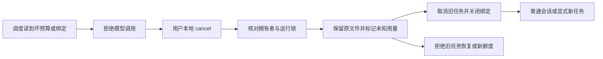

# Gemini Ultra CLI 工作流状态恢复交接

日期：2026-11-11。候选 preview.35，本机此时仍 preview.34。

## E-135 / F-036：损坏账本无法取消

E-134 已复现：坏 JSON 预算会阻断模型调度，也使 cancel 失败。此次沿用 R26/code-audit、lead/cae/doc 及已授权本地 scope，修复工作流预算与绑定文件的恢复；没有访问外部安全目标或调用真实供应商。

显式 `/boost cancel`、`/teamwork cancel`、`/grill-me cancel`
现在将坏预算重命名为 UUID 唯一备份，保留原始字节，再写入关闭的未知用量记录。坏绑定 current.json 同样保留后修复；健康账本的已知累计用量不变。读权限、写权限等真实 I/O 错误继续上报，不当作可随意丢弃的格式错误。

预算版本和独立拥有进程信息同步保存到工作流记录。丢失已跟踪账本、缺失必要计数字段、UUID 不匹配、非法字段或超过读取上限都会拒绝分发，不能被默认值当成新预算。已有活拥有者/运行锁存在时拒绝恢复。旧记录的迁移保留；已知已跟踪记录丢账本时不伪装成旧格式重置用量。

恢复前先持久化“旧用量不可确认”标记，防止移动文件后进程中断让它重新获得额度。原任务可取消并保留报告，但不能恢复或调大预算；需要用户创建新的有边界任务。状态摘要把未知请求、失败和实施轮数显示为 null，不把它们当成真实零消耗。删除替代账本也无法清除工作流记录里的未知标记。

## E-136 / F-037：本地命令被继续交给模型

非交互入口原先把 action 返回 undefined 的本地斜杠命令视为“没有 prompt”，再把原输入送进模型。现在返回独立的本地已处理标记，主循环直接收尾；真正 submit_prompt 的命令继续原流程。命令 UI 报错以项目已有 FatalInputError（退出码 42）结束，不能误返回成功后调用模型。未知命令保留原处理行为。

## 必要验证

- 23 个相关 core 用例（恢复 9、工作流 11、错误交接 3）通过；2 个选定非交互用例通过，其余 67 个未运行。覆盖坏 JSON、Schema、缺计数字段、错误 UUID、超大文件、缺失账本、损坏绑定，以及绑定也坏掉时由独立进程信息阻止干扰活拥有者。没有全量/冒烟。
- 受影响严格 lint、core/CLI 类型构建、格式和 diff 检查通过。初次类型检查指出 UI 错误文本可能 undefined，补明确默认文本，未放宽类型。
- 源码 bundle 实际执行：初始坏状态拒绝（退出 1）→
  `/boost cancel`（退出 0、0 模型请求）→
  `/boost resume`（退出 42、0 模型请求）→ 普通会话（退出 0、1 个 loopback 请求）。全场景 7162ms、2 个 loopback 请求；第一个仅创建隔离坏状态，第二个为明确的普通会话。两个备份字节匹配、旧任务 cancelled/用量未知、无交付工件。
- 初版辅助报告 false 的唯一原因是把 FatalInputError 期望成退出 1；源码 errors.ts 明确定义 42。保留 workflow-recovery-source-initial-result.json 和原输出，用 workflow-recovery-source-reviewed-result.json 重评同一捕获记录，标明 newExecution=false，未重复场景。CI 使用修正的断言执行最终包。

Evidence→Finding→Path：E-134 取消和调度同时被损坏账本阻断 → F-036 →
E-135 本地保留恢复和未知用量禁复活；非交互 void action 继续默认模型路径 → F-037
→ E-136 独立已处理标记及真实 CLI 零请求取消/拒绝恢复。

工程证据：workflow-recovery-core.log、workflow-recovery-final.log 和 junit；workflow-recovery-headless.log/junit；workflow-recovery-types.log、workflow-recovery-lint.log、workflow-recovery-final-lint.log；workflow-recovery-source-initial-result.json、workflow-recovery-source-initial-output.txt、workflow-recovery-source-reviewed-result.json。源码 bundle 不代替三平台最终工件与安装核对。

## 接续边界

WI-065 工作流预算/绑定恢复本地完成，preview.35 待分发安装。Swarm 的预算嵌在 members.json 中，整个 Swarm 状态或其绑定损坏的取消恢复尚未统一，继续 WI-066；不要把此修复扩大为任意项目状态文件都已可恢复。原始 workflow 记录本身若损坏也需独立恢复方案。真实供应商自主交付/引用可靠性、复杂逆向、隔离工作树和成员独立模型仍未完成。goal
active，不合并 master、不发布正式 Release。
