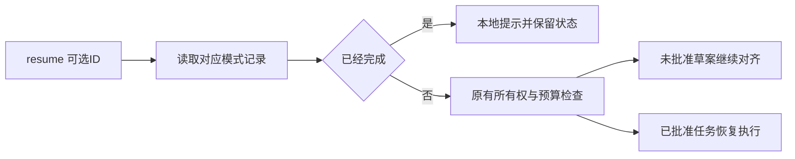

# Gemini Ultra CLI 指定工作流恢复交接

日期：2026-11-11。WI-086，候选 preview.54。沿用 R26/code-audit 自有源码 case，lead/cae/doc。E-198 是一次新任务，没有重跑49本地化或旧Swarm任务；没有外部安全目标、个人配置/数据库/本机逆向工具改动。

## 真实 Teamwork 与代码归属

已安装53使用当前配置的 deepseek/deepseek-v4.1-flash，在隔离 Git 快照上完成两个里程碑：指定ID恢复、已完成任务本地返回。只提供实际 agentWorkflowCommands.ts 与 SPEC.md，禁止模型 shell/测试/额外文件；prepare/budget32/失败2/每里程碑1轮/workspace
on 均零模型，需求草案3真实请求、未批准前0实施，再由宿主显式批准。

E-198最终 blocked，392200ms、32实际请求、没有宿主超时，预算规则正常停止。里程碑1完成实施及独立审查；里程碑2调查完成，coder因预算中止，不能称完整 Teamwork 交付。原记录5份阶段报告与
[true,false]
里程碑保持，没有自动加预算或付费重试。响应报告587792输入+34521输出=622313
token，非账单。临时凭据已删除；个人供应商文件 SHA 与运行前相同，实际源码在离线复核前字节不变。

宿主保留并审查第一阶段部分补丁，git apply
--check 后复用指定ID读取和模式校验改动；删去读取函数永远不会返回 undefined 的冗余检查。completed 分支、描述和用法由宿主补齐，不能归功于已阻塞的第二阶段。快照/独立工作树/原始输出和部分补丁留存，未修改原任务状态为成功。

## 实现与证据链

F-054：resume 忽略传入ID，且 completed 工作流会重新激活预算、重置为 ready 并提交模型提示。现 Boost/Teamwork/Grill-me 的 resume
ID 直接读取对应记录并检查模式，坏ID/缺失记录/错模式不回退。无ID沿用最近选择。completed 在预算、权限、保存和执行操作前本地返回，包含任务ID的当前语言提示；不再次执行或花费模型请求。

未批准的 Teamwork 恢复仍为 Plan
Mode/scoping，批准状态保持 false。所有权、累计预算、其他待处理工作流、损坏记录/未知用量保护与 worktree 路由沿用既有逻辑。Swarm 的历史执行选择器未新增。

Evidence → Finding → Path：E-198实际原生任务/部分交付与4项旧回归失败 →
F-054错误选择及 completed 重放 → 复用有效改动、宿主补齐本地终态返回 →
14项命令检查、原生已完成只读与历史草案选择。真实 Teamwork 失败与后续宿主实现分开评价。

## 验证与分发

旧4项回归失败；修后14项相关命令检查及严格lint/type通过。源码原生14命令，11退出0/3预期42，只有恢复历史未批准草案时1次loopback请求。三种模式 completed 的显式/无ID及中文别名均本地返回；7个已完成记录/账本/绑定文件哈希保持。历史草案正确进入scoping/approved=false，累计请求7→8是这次真实调度，限制、失败数和实施轮数保持。

最初夹具把宿主活PID作为旧拥有者，正确触发所有权拒绝；改为真实已退出的子进程PID。第二次夹具误把恢复后的请求数仍写为7，修正为8；保留两次失败，不修改产品所有权或预算逻辑。最终源码以 workflow-resume-source-accepted 为准，不重复已完成付费任务。

工程 C:\Users\Administrator\Documents\ChatGPT\gmncliu：`preview53-live-teamwork-resume-*`、`run-live-teamwork53.mjs`、`observe-live-teamwork53.mjs`；`workflow-resume-before*`、`workflow-resume-junit.xml`、`workflow-resume-test.log`、`workflow-resume-types.log`、`workflow-resume-lint.log`、`workflow-resume-final-script-lint.log`、`workflow-resume-source*`。源码报告version取根包nightly，不是最终包版本。

候选54只运行 workflow-resume 范围三平台新鲜包/安装及本次原生链。47协作、48供应商、49报告、50提交恢复、51Ghidra、52压缩、53目录基线保留。最终源码/CI/工件哈希/安装结果待追加。goal
active；真实Teamwork完整自主交付仍待，现有预算/实际读取冗余和长会话语义等问题仍需后续处理。不合并 master 或创建正式 Release。
